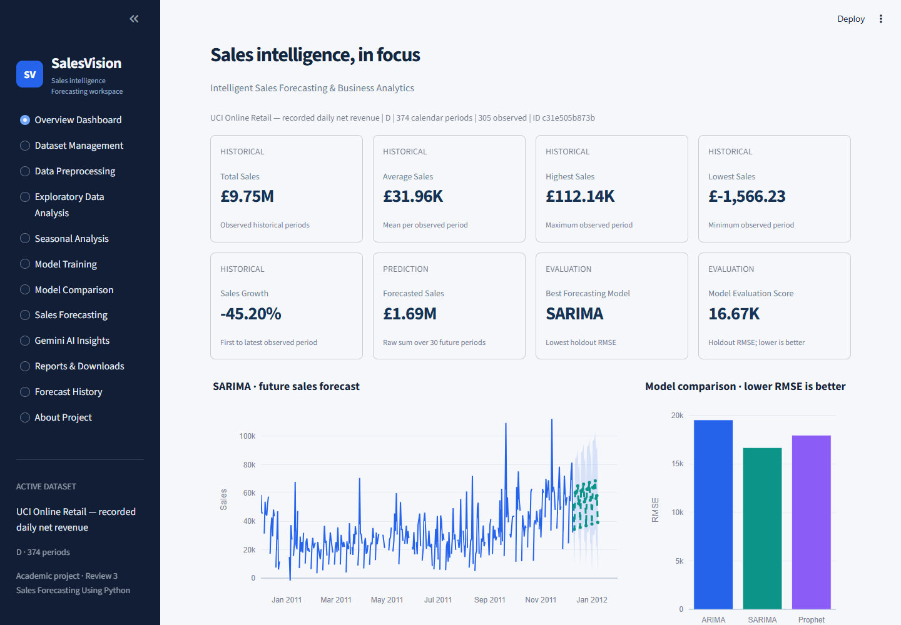

# SalesVision

## Sales Forecasting Using Python · Business Analytics · Review 3

SalesVision turns historical CSV/Excel sales data into audited analysis, measured model comparisons, future forecasts, business explanations, and downloadable reports. Its Streamlit application, experiment script, and notebook share the same Python services.



### Implemented workflow

1. Load historical sales and inspect its schema, quality, and provenance.
2. Choose explicit cleaning, filtering, missing-period, and aggregation policies.
3. Explore observed sales and run robust STL seasonal decomposition.
4. Evaluate genuine ARIMA, SARIMA/SARIMAX, and Prophet models on one chronological holdout.
5. Select the lowest valid error score and retrain on full history for future forecasting.
6. Explain aggregate computed evidence with optional Gemini or labelled local analytics.
7. Export CSV, Excel, and illustrated PDF reports; save and compare SQLite forecast history.

The dashboard includes 12 workspaces, eight computed overview KPIs, interactive Plotly charts, and narrow-screen layouts. Unknown observations remain separate from model-input imputations. Each forecasting execution receives its own history identifier, including cached computations.

## Quick start

Use **Python 3.12**. Local verification used Python **3.12.10 on Windows 11**. Run commands from the unpacked `sales-forecasting-system` directory.

```powershell
py -3.12 -m venv .venv
& ".venv\Scripts\python.exe" -m pip install -r requirements.txt
& ".venv\Scripts\Activate.ps1"
streamlit run app.py
```

If activation is unavailable, launch directly:

```powershell
& ".venv\Scripts\python.exe" -m streamlit run app.py
```

Open the local URL printed by Streamlit. The included real UCI daily sample allows the numerical workflow to run offline. Gemini is optional.

### Reproduce the demonstrated results

In **Dataset Management**, load `UCI real retail · uci_online_retail_daily.csv`. In **Data Preprocessing**, select daily total sales and **Forward-fill (past values only)**; retain duplicates and negative net returns. Apply preprocessing.

In **Model Training**, use all three models, a **30-day** chronological holdout, **RMSE** selection, and **3** rolling-origin folds of **14** periods. Retain the default ARIMA/SARIMA orders; set Prophet yearly seasonality **Off** and within-week seasonality **On**. Generate a **30-day** future forecast in Sales Forecasting.

The reproducible CLI is:

```powershell
& ".venv\Scripts\python.exe" scripts/run_experiments.py
```

To save a separate offline experiment:

```powershell
& ".venv\Scripts\python.exe" scripts/run_experiments.py --output outputs/experiments/uci_daily_local
```

## Actual real-data findings

The included experiment uses **UCI Online Retail**, a UK online retailer's recorded **GBP net revenue**, derived from 541,909 invoice lines under **CC BY 4.0**. Its 305 observed dates span 374 calendar days from `2010-12-01` to `2011-12-09`. The 69 unknown dates are causally forward-filled for model input only.

All models trained on the first **344 calendar days** and predicted the same final **30-day holdout**. Only **26 genuinely observed holdout targets** were scored.

| Model | MAE (GBP) | RMSE (GBP) | MAPE (%) | sMAPE (%) |
|---|---:|---:|---:|---:|
| ARIMA | 14,384.500 | 19,529.031 | 29.658 | 26.746 |
| SARIMA | 12,076.296 | **16,669.560** | 26.450 | 22.147 |
| Prophet | 12,312.633 | 17,955.768 | **21.492** | 22.147 |

**SARIMA is selected among the three candidates by RMSE. The seven-day seasonal-naive baseline has a lower RMSE of GBP 15,328.037.** The experiment therefore does not establish superiority over that stronger baseline. Prophet's lower MAPE does not change an RMSE-based selection.

Full-history SARIMA generates 30 future dates, `2011-12-10`–`2012-01-08`, with a raw point-forecast total of **GBP 1,693,961.86**. These dates are future relative to the archived data; future accuracy cannot be measured without labelled outcomes. Individual period intervals are not a joint interval for total revenue.

Detailed configurations, signed bias, backtesting, assumptions, and artifacts are in [experimental results](docs/experimental_results.md) and [the executed findings](outputs/experiments/uci_daily/results.md).

## Gemini configuration

Create a local `.env` using `.env.example` as the template and set `GEMINI_API_KEY` there, or use server-side Streamlit secrets. The default model is **`gemini-3.1-flash-lite`**. Earlier live generation succeeded; the final audit recheck reached the model but generation returned **`service_unavailable`**, so the refreshed experiment uses **Local analytics**. `GEMINI_MODEL` and the UI model field are configurable for account-specific availability.

Gemini receives aggregate historical statistics, STL diagnostics, evaluation scores, and forecast summaries. It supplies explanations; all numerical forecasting is performed in Python. Missing credentials, quota, network, model, or response failures produce explicitly labelled **Local analytics** without preventing forecasting. Keep credentials out of source code, screenshots, notebooks, and shared archives; rotate any key exposed in chat.

## Notebook and portable delivery

- [Sales_Forecasting_Experiments.ipynb](notebooks/Sales_Forecasting_Experiments.ipynb) contains a 16-section experiment with executed local outputs.
- Execute it with `python scripts/execute_notebook.py` inside the project environment.
- The notebook writes to `outputs/experiments/uci_daily_notebook/`, preserving the separate CLI experiment.
- [Colab instructions](docs/colab.md) cover project ZIP upload, optional Drive mounting, dependencies, hidden key entry, and result downloads. Hosted Colab execution has not been verified.
- Create the portable archive with `python scripts/package_project.py`; its default output is `outputs/salesvision_project.zip`.
- The archive includes source, documentation, screenshots, sample data, the notebook, and real CLI results. Runtime databases, credentials, original customer-level source files, caches, and the virtual environment are excluded.
- The final **153-file** archive includes the faculty manual/PDF/generator and passed integrity/current-source checks and a fresh extracted-app Chrome smoke, loading 305 real records and preprocessing 374 daily periods. Detailed results are recorded in `outputs/qa/delivery-results.json`.
- `.gitattributes` preserves source, dataset and generated artifact bytes in Git so provenance hashes and manifest checksums remain reproducible after cloning.

## Project layout

```text
sales-forecasting-system/
├── app.py                         Streamlit entry point
├── config/                        Environment-backed settings
├── assets/                        Dashboard styling
├── .streamlit/                    Streamlit theme and upload settings
├── src/
│   ├── data/                      Loading, validation, audited cleaning, aggregation
│   ├── features/                  Observed statistics and robust STL
│   ├── forecasting/               Genuine models and full-history forecasting
│   ├── evaluation/                Metrics, holdout selection, rolling backtests
│   ├── ai/                        Official Gemini SDK and local explanations
│   ├── visualization/             Interactive and report charts
│   ├── reports/                   CSV, Excel, PDF, reproducible snapshots
│   ├── database/                  Transactional SQLite history
│   ├── experiments/               Shared real-data experiment
│   ├── ui/                        Connected dashboard workspaces and cache
│   └── utils/                     Errors, serialization, logging
├── data/sample/                   Real UCI sample and labelled synthetic fixture
├── notebooks/                     Executed reproducible notebook
├── scripts/                       Acquisition, experiments, QA, packaging
├── tests/                         Unit and real-model/UI integration checks
├── docs/                          Guides, diagrams, results, screenshots
└── outputs/experiments/uci_daily/  Executed real-data evidence
```

## Documentation

### Faculty demonstration and beginner guide

For Review 3, use the complete [editable faculty demonstration guide](docs/faculty_demonstration_guide.md) and its [formatted PDF](outputs/SalesVision_Faculty_Demonstration_and_User_Guide.pdf). They include Windows setup, all twelve workspaces, speaking scripts, model/metric explanations, 52 viva answers, checklists, timelines and genuine screenshots. Regenerate the PDF with `python scripts/build_faculty_guide.py` in the development environment.

| Guide | Contents |
|---|---|
| [Installation](docs/installation.md) | Python environment, configuration, launch, native-library troubleshooting |
| [Architecture](docs/architecture.md) | Module responsibilities, data-flow, execution sequence, SQLite ER diagram |
| [Methodology](docs/methodology.md) | Data policies, models, leakage prevention, metrics, uncertainty |
| [User guide](docs/user_guide.md) | All 12 pages, supported frequencies, inputs, reports, history |
| [Experimental results](docs/experimental_results.md) | Actual UCI measurements, baselines, provenance, interpretation |
| [Colab and notebook](docs/colab.md) | Local execution, project upload, Drive, downloads |
| [Testing](docs/testing.md) | Reproducible checks and verified evidence |
| [Final project audit](docs/FINAL_PROJECT_AUDIT.md) | Root-cause fixes, measured counts, acceptance results and limitations |
| [Review 3 demonstration](docs/review3_demo.md) | Demonstration sequence, delivery items, presentation and viva notes |
| [Screenshot gallery](docs/screenshots/README.md) | Actual desktop and narrow-screen captures |

## Validation and scope

The final suite passed **160/160 tests** in both the project environment and a newly created, pinned isolated environment. Actual Chrome QA passed **63 checks**, generated **16 screenshots**, exercised all 12 pages at 390-pixel width, and fitted/evaluated/forecasted ARIMA, SARIMA and Prophet on daily, weekly and monthly data. The fresh local notebook completed **15/15 code cells with zero errors** and reproduced the CLI measurements. The complete browser run used **Local analytics**; the separate final live Gemini recheck recorded temporary provider unavailability. See [testing](docs/testing.md) and [the final audit](docs/FINAL_PROJECT_AUDIT.md) for measured evidence.

Daily, anchored weekly, and monthly observations are supported; finer-frequency sales are never inferred from coarser observations. Optional regressors require actual aligned values known at the forecast origin. The UCI daily sample lacks store/department/holiday dimensions, so those views require a suitable source.

Walmart competition CSVs are supported through manual upload and validated ancillary joins. They were not available for this experiment, and UCI results are not Walmart findings. The separately labelled synthetic weekly fixture validates software behavior only. The measured local environment and narrow browser viewports do not imply hosted-Colab, physical-device, or production deployment verification.

## Dataset attribution

Chen, D. (2015). *Online Retail*. UCI Machine Learning Repository. DOI: [10.24432/C5BW33](https://doi.org/10.24432/C5BW33). Source: <https://archive.ics.uci.edu/dataset/352/online+retail>. License: [CC BY 4.0](https://creativecommons.org/licenses/by/4.0/).

The sample derives daily revenue as `Quantity × UnitPrice`, retaining refunds/cancellations and exact source duplicates while excluding customer identifiers. Preserve this attribution when redistributing the derived sample. Software dependency licenses remain those of their respective projects; the dataset license does not assign a software license to this repository.
