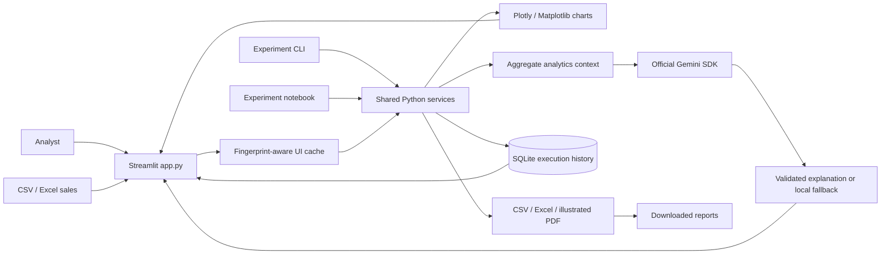
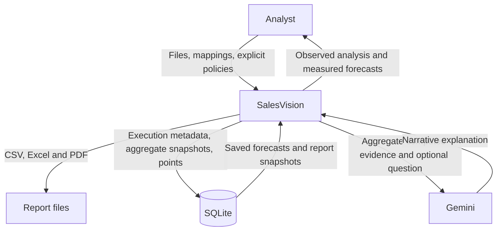
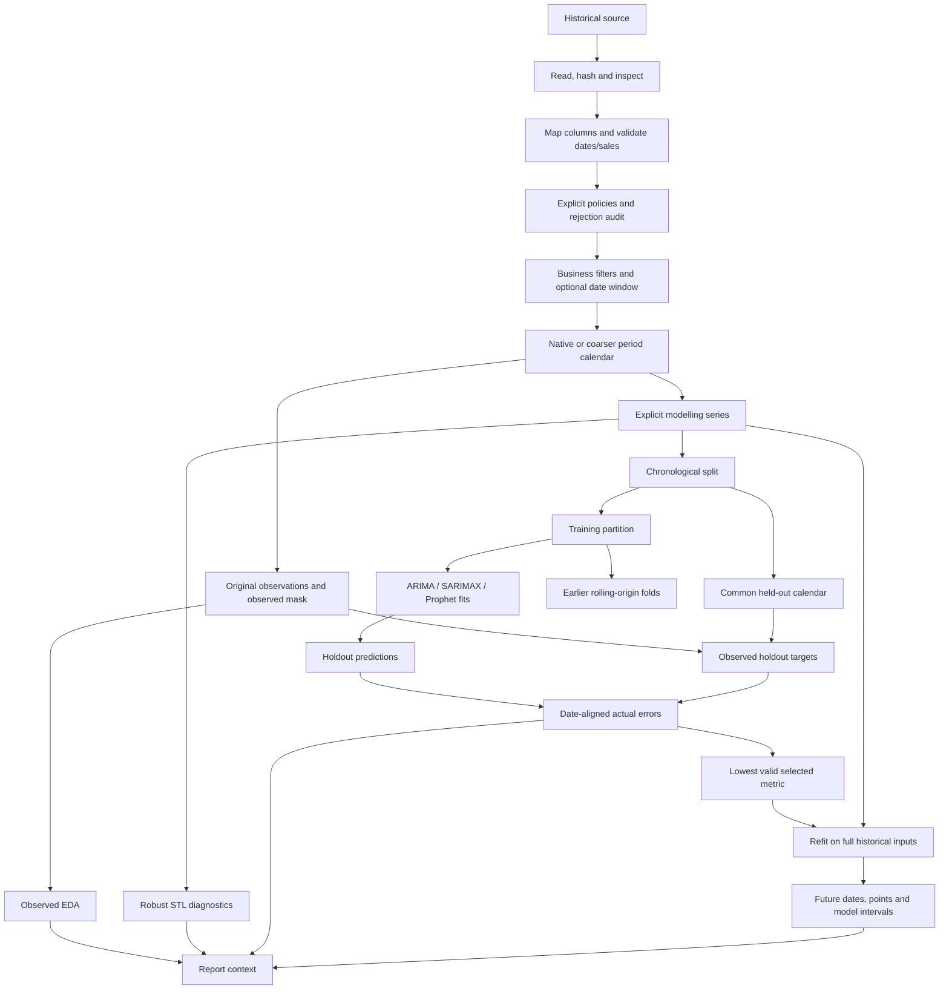
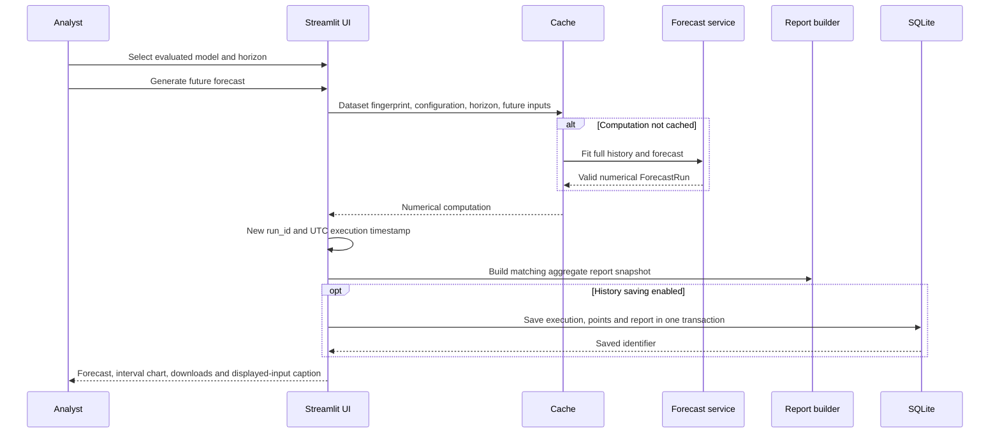
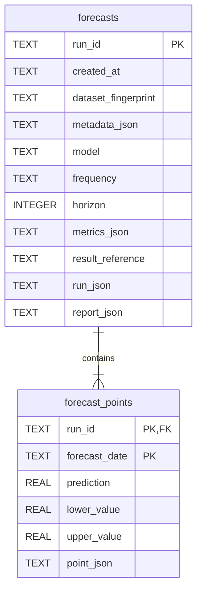

# Architecture and diagrams

## System overview

SalesVision is a local Python application with three entry points: a Streamlit dashboard, a real-data experiment CLI, and an experiment notebook. All three use the same data, analysis, model, evaluation, report, and explanation services.

## Module responsibilities

| Location | Responsibility |
|---|---|
| `app.py` | Settings, session navigation, theme, database initialization, user-facing errors |
| `config/settings.py` | Environment/secret configuration and writable application directories |
| `src/data/` | Ingestion, mapping, validation, audited cleaning/filtering, calendar aggregation |
| `src/features/time_features.py` | Observed summaries, rollups, segment/holiday analysis, robust STL |
| `src/forecasting/` | Model configuration, valid calendars/regressors, actual fitting and inference |
| `src/evaluation/` | Date-aligned metrics, chronological holdout, rolling-origin validation, selection |
| `src/visualization/charts.py` | Responsive interactive charts and report images |
| `src/ai/` | Aggregate prompts, official SDK, bounded requests, validated narrative, fallback |
| `src/reports/report_generator.py` | Report snapshots and spreadsheet-safe CSV/Excel/PDF outputs |
| `src/database/db_manager.py` | Transactional executions, points, snapshots, comparison and deletion |
| `src/ui/` | Twelve connected workspaces, controls, cache and active-result checks |
| `src/experiments/retail_experiment.py` | Prespecified UCI experiment, baselines, findings, artifact manifest |
| `src/utils/` | Application errors, JSON/dataframe serialization, secret stripping, logging |

## Level-0 data flow

Automatically assembled Gemini evidence contains aggregate analytics. User-entered questions are included in the request; they should describe the available analytics without adding sensitive row-level details.

## Level-1 numerical pipeline

The backtest uses only the earlier training partition. The final holdout determines candidate selection. Final forecasting is a separate full-history fit.

## Main contracts

- **`LoadedDataset`**: original dataframe, filename, byte size, and content SHA-256.
- **`ColumnMapping`, `CleaningOptions`, `AggregationOptions`**: explicit, immutable processing choices.
- **`ProcessedDataset`**: model-input series, original observed series, observed mask, cleaned records, regressors/holidays, quality/audit, rejected records, metadata and fingerprint.
- **`ModelConfig`**: model/order/seasonality/interval/regressor settings and seed.
- **`EvaluationResult`**: shared split boundaries, actual comparison, holdout predictions, configurations, fitting summaries/warnings, optional backtest.
- **`ForecastRun`**: full-history forecast table, execution identity/time, configuration, evaluation references, fitting details, components and warnings.
- **`ReportContext`**: serializable aggregate history and report snapshot. Evaluation, forecast and seasonal calendars must match the dataset context.
- **`InsightResult`**: explanation source/status/time/model and aggregate-context hash; stale explanations are excluded.

Required forecast columns are `date`, `prediction`, `lower`, and `upper`. The model service validates shape, dates, finite values, and interval ordering before use.

## Forecast execution sequence

## State, caching and provenance

Activating a source invalidates processed data and every downstream result. Applying preprocessing invalidates model/forecast/seasonal/explanation/report state. New model evaluation invalidates forecasts, explanations, and reports; new decomposition invalidates explanation/report state. Generating a new forecast also invalidates the current explanation/report.

Active evaluation and forecast checks compare the current dataset fingerprint. Forecast selectors have stable dataset-specific keys and restore their last generated model/horizon after page navigation. A displayed-forecast caption distinguishes an existing result from inputs awaiting regeneration.

Persistent widget helpers deep-copy values into `session_state["control_values"]` before Streamlit removes widgets from an inactive page. Outside forms, change callbacks retain values; form submissions retain their submitted settings. The model-selection multiselect is outside the deferred training form so availability and parameter panels update immediately.

Fingerprint inputs include processing choices and provenance. The original workbook's `source_sha256` is preserved; the loaded derived CSV has a separate `dataset_file_sha256`. UI ingestion records additional source metadata such as upload size, so UI and CLI provenance fingerprints may differ even when numerical inputs and measured metrics agree.

Ancillary uploads retain their original byte hashes. `joined_dataset_sha256` identifies the join separately from original history bytes and includes driver-file identities, including small numeric changes. Snapshot serialization preserves small floats and nanosecond dates; restored metadata, configuration, shape and calendar contracts are validated.

## SQLite ER diagram

- Short-lived connections use foreign keys, a 10-second busy timeout, WAL, transactions, and guaranteed closure.
- Indexes support execution-time and dataset-fingerprint lookups.
- Re-saving an identical execution updates its report snapshot; a conflicting run with the same ID is rejected.
- Refreshing or deleting a saved snapshot invalidates its generated-PDF UI cache.
- Saved comparison requires matching dataset/preprocessing/frequency and intersects the actual future dates.
- Confirmed deletion cascades to points. Current analysis changes do not remove saved history.
- JSON snapshots preserve reproducible aggregate results; secret-named fields are stripped by serialization.

Database initialization errors are typed. The entry point continues with history disabled if persistence is unavailable; it preserves existing database bytes. File-logging failures fall back to server stderr. PDF and Excel share aggregation-aware target definitions and statistic/monthly labels.

## External and persisted boundaries

Raw uploaded files are persisted only when the user selects source saving. SQLite/report snapshots store aggregate historical periods, forecast points, configurations, measured errors and explanations. The original customer-level UCI workbook, API credentials, runtime history, and caches remain outside the portable project archive.

Numerical services work without a Gemini connection. Provider results undergo structured-response and cited-section validation, while deterministic local explanations remain available for classified failure states. This validation is not a formal proof of every generated sentence; explanations should be checked against their displayed evidence.
