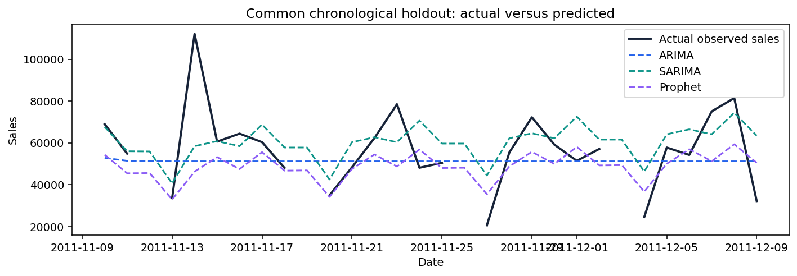
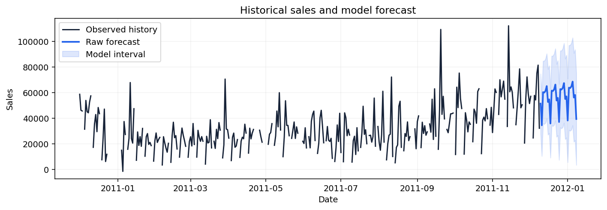

# Executed real-data experiment

## Evidence and scope

These findings come from an executed **UCI Online Retail** experiment, not simulated figures or Walmart measurements. The CLI and notebook use `src/experiments/retail_experiment.py` and the same services used by the Streamlit application.

The CLI manifest records execution on **2026-11-16**, Python **3.12.10**, NumPy `2.2.6`, Pandas `2.3.3`, SciPy `1.15.3`, Statsmodels `0.14.4`, Prophet `1.1.7`, CmdStanPy `1.2.5`, and `google-genai==1.26.0`.

## Dataset and target

| Property | Observed value / explicit choice |
|---|---|
| Source | UCI Online Retail; Chen, D. (2015), DOI `10.24432/C5BW33` |
| License | CC BY 4.0 |
| Population | One UK-based online retailer |
| Original invoice lines | 541,909 |
| Source interval | `2010-12-01`–`2011-12-09` |
| Target | Recorded daily GBP net revenue, `sum(Quantity × UnitPrice)` |
| Negative-revenue source lines | 9,290, retained |
| Exact duplicate source lines | 5,268, retained |
| Derived recorded dates | 305 |
| Complete daily calendar | 374 |
| Unknown calendar dates | 69 |
| Model-input gap policy | Explicit causal forward-fill |
| Scoring/statistics policy | Preserve unknown actuals; use original observed targets |
| Customer identifiers | Excluded from derived daily data |

Observed historical net revenue is **GBP 9,747,747.93**; mean recorded-day revenue is **GBP 31,959.83**. The minimum is **GBP −1,566.23** and maximum **GBP 112,141.11**. There is one negative aggregated day and no observed zero-sales day. These period counts differ from the negative invoice-line count.

Endpoint growth is **−45.20%** from the first to latest observed day. It is not an estimate of the retailer's underlying causal trend. Months and weekday summaries can be affected by missing observations and boundary coverage.

## Prespecified design

- ARIMA `(1,1,1)`, max iterations 150.
- SARIMA `(1,1,1)(0,1,1,7)`, max iterations 150.
- Additive Prophet: weekly on, yearly/intraday off, changepoint prior 0.05.
- Shared seed **42**, interval width **95%**, no regressors or supplied holidays.
- No random split or holdout-directed parameter search.
- Training: **344 calendar days**, ending **2011-11-09**.
- Final common holdout: **30 days**, **2011-11-10**–**2011-12-09**.
- **26** original observed holdout targets scored; four unknown targets excluded from every model's metrics.
- Three earlier expanding-window backtests of 14 days, inside training only.

The final holdout chooses the lowest valid **RMSE** among the three candidates. Naive forecasts provide separate benchmarks.

## Final holdout measurements

| Model | MAE (GBP) | RMSE (GBP) | MAPE (%) | sMAPE (%) | Bias (GBP) | Scored targets | Status |
|---|---:|---:|---:|---:|---:|---:|---|
| ARIMA | 14,384.500 | 19,529.031 | 29.658 | 26.746 | −5,150.079 | 26 | success |
| SARIMA | 12,076.296 | **16,669.560** | 26.450 | 22.147 | 4,013.102 | 26 | success |
| Prophet | 12,312.633 | 17,955.768 | **21.492** | 22.147 | −7,436.187 | 26 | success |

Bias uses `mean(prediction - actual)`: SARIMA overpredicts on average in this window, while ARIMA/Prophet underpredict. MAPE and sMAPE use absolute denominators and are percentage errors, not accuracy percentages. Full-precision values are in `model_comparison.csv`; rounded sMAPE values can conceal small differences.



## Naive benchmarks and the central finding

| Baseline | MAE (GBP) | RMSE (GBP) | MAPE (%) | sMAPE (%) |
|---|---:|---:|---:|---:|
| Last-value naive | 15,008.011 | 19,868.400 | 36.903 | 27.298 |
| Seven-day seasonal naive | 12,353.891 | **15,328.037** | 26.386 | 22.673 |

The seasonal naive repeats the last seven training-input values, without reading future targets. Both baselines use the same observed holdout mask as the models.

**SARIMA wins the application's three-model RMSE comparison but does not beat the stronger seasonal-naive baseline.** This result argues for retaining baseline benchmarks and testing additional windows before preferring model complexity. Prophet wins on MAPE in this case, illustrating why the selection criterion must be declared.

## Training-partition rolling-origin validation

| Fold | Training end | Validation interval | Calendar days | Observed targets |
|---|---|---|---:|---:|
| 1 | 2011-09-28 | 2011-09-29–2011-10-12 | 14 | 12 |
| 2 | 2011-10-12 | 2011-10-13–2011-10-26 | 14 | 12 |
| 3 | 2011-10-26 | 2011-10-27–2011-11-09 | 14 | 12 |

| Model | Pooled observed-target RMSE (GBP) | Completed folds | Status |
|---|---:|---:|---|
| ARIMA | 15,668.915 | 3 | success |
| SARIMA | **13,738.304** | 3 | success |
| Prophet | 14,887.998 | 3 | success |

Pooled errors are recomputed from the 36 original observed validation targets, not obtained by averaging fold RMSEs. These windows end before the final holdout and do not replace its selection result.

## Seasonal diagnostics

Robust STL on the explicitly forward-filled inputs used a **7-day** cycle:

- Seasonal strength: **0.386**.
- Seasonal 5th–95th percentile amplitude: **GBP 26,747.51**.
- Residual standard deviation: **GBP 9,898.85**.

This is descriptive evidence of a moderate repeating component under the selected gap policy. It does not prove a holiday effect, ensure future repetition, or justify enabling yearly Prophet terms on approximately one year of history.

## Full-history future forecasts

All three candidates were separately refitted on **all 374 calendar periods** and produced **30 future rows** from **2011-12-10 to 2012-01-08**. The RMSE-selected SARIMA raw point-total is **GBP 1,693,961.86**.



These future dates belong to the archived study. No labelled future targets are available, so no future accuracy claim is made. The preceding equal-length historical window contains unknown dates; the application's equal-horizon growth metric is therefore unavailable. Period model intervals are not a joint confidence interval for summed revenue.

## Reproducibility and artifact map

```powershell
& ".venv\Scripts\python.exe" scripts/run_experiments.py --output outputs/experiments/uci_daily_local
& ".venv\Scripts\python.exe" scripts/execute_notebook.py
```

The refreshed CLI experiment is in `outputs/experiments/uci_daily/`; its attempted live explanation fell back to Local analytics with `service_unavailable`. Notebook execution writes separately to `outputs/experiments/uci_daily_notebook/` and uses offline Local analytics. MAE/RMSE/MAPE/sMAPE are compared at `rtol=1e-5`, `atol=1e-3`; execution IDs, timestamps, fit durations, generative wording and report bytes can vary.

| Artifact | Contents |
|---|---|
| `manifest.json` | Versions, seed, hashes, split, configurations, status and artifact checksums |
| `dataset_metadata.json`, `quality.json`, `cleaning_audit.csv` | Provenance and explicit processing evidence |
| `processed_calendar.csv`, `statistics.json` | Observed versus filled series and original statistics |
| `seasonal_components.csv`, `seasonal_diagnostics.json` | Executed robust STL |
| `model_comparison.csv`, `baseline_comparison.csv` | Actual common-holdout errors |
| `*_holdout.csv`, `*_holdout_summary.txt` | Model predictions, observed mask and fitted diagnostics |
| `backtest_comparison.csv`, `backtest_folds.csv`, `*_backtest.csv` | Earlier-window pooled/fold measurements |
| `*_future_forecast.csv`, `*_full_history_summary.txt` | Genuine final full-history fits and future outputs |
| `insights.json` | Explanation's actual provider/local source, status and context hash |
| `report_snapshot.json`, `salesvision_report.xlsx`, `salesvision_report.pdf` | Aggregate report snapshot, 16-sheet workbook, 9-page illustrated PDF |
| `results.md`, five PNG figures | Executed interpretation and plotted arrays |

The manifest checks **37 artifact SHA-256 values**. Original workbook SHA-256:

`43465a06f2ccf7c8b5bd2892bc7defb52f97487934fe93b16ae4c3936424676d`

Derived daily CSV SHA-256:

`d9b2e2d967602d1aa41fcdb48701ba5d5bc07c4bed056ce21e8f23eebaaeef5c`

CLI/notebook processed-dataset fingerprint:

`c40c7a2d953a48c7c668e979f4b87a011afccf2f6d969a037936b58f9d2adf02`

UI ingestion may include additional provenance metadata and thus a different fingerprint; actual browser-exported metrics reproduced the CLI/notebook measurements within the stated tolerance.

## Live Gemini evidence

Earlier live generation succeeded with **`gemini-3.1-flash-lite`**, including the earlier CLI and Streamlit workflow. The final audit independently rechecked the provider: model lookup succeeded, but generation returned **`service_unavailable`**. The refreshed CLI `insights.json` and manifest therefore record **Local analytics** and that actual failure status. The final complete 63-check Chrome run also used Local analytics. The notebook's offline result is correctly labelled `missing_key`.

Local `outputs/qa/gemini-3.1-flash-lite.json` preserves the earlier successful generation; `outputs/qa/gemini-audit-final.json` records the final live recheck. Provider availability is an external limitation, and the final results do not claim a successful fresh live generation.

Model metadata lookup alone was insufficient for an older model in the verified account. Availability is account/provider dependent; classified failure states preserve the numerical workflow.

## Limits and next research steps

The evidence covers one retailer, retained net returns/duplicates, an explicit filled-input assumption, fixed candidate settings, one final holdout and three earlier windows. It does not establish Walmart performance, global optimality, current-day forecasts, interval coverage or inventory quantities. Legitimate additional sources, gap-policy sensitivity, stronger baseline selection, multiple temporal windows and actual unit/price/lead-time data are appropriate future investigations.
