# SalesVision Faculty Demonstration and User Guide

**Sales Forecasting Using Python | University Minor Project | Review 3**

Windows 11 beginner edition. Prepared from the actual application and retained November 16, 2026 verification evidence. This is an operating manual, speaking script and viva companion, not a claim of production deployment. The numerical demonstration works offline with the included UCI sample. Gemini is optional: its latest recorded generation returned `service_unavailable`; Local analytics remained available.

## 1. Project orientation and verified scope

SalesVision is a Python/Streamlit application for Business Analytics. It turns historical sales into audited preparation, charts, seasonal analysis, fair model comparison, future forecasts, explanatory text, reports and saved history. There is no separate JavaScript frontend, FastAPI server or required live Colab connection.

The sidebar contains exactly twelve workspaces: Overview Dashboard; Dataset Management; Data Preprocessing; Exploratory Data Analysis; Seasonal Analysis; Model Training; Model Comparison; Sales Forecasting; Gemini AI Insights; Reports & Downloads; Forecast History; About Project. The last page's main heading is About SalesVision.

Inspected implementation: `app.py`, `config/settings.py`, `.streamlit/config.toml`, the shared data loader/validator/pipeline/aggregator, `src/features/time_features.py`, ARIMA/SARIMA/Prophet services, metrics/comparison/backtesting, Gemini client/insight generator, SQLite manager, report generator, UI dashboard/widgets, README, installation/user/methodology/demo guides and final audit. Detailed source paths are in `docs/architecture.md`.

Recorded acceptance: 160 passing tests in the project environment and 160 in a fresh pinned environment; 63 actual-Chrome checks; all twelve narrow layouts; 15/15 fresh local notebook code cells. Daily, anchored-weekly and monthly genuine model workflows passed. Weekly dimension/holiday/driver evidence is explicitly synthetic, not Walmart research. Hosted Colab, physical phones and other operating systems remain untested.

## 2. Windows 11 installation and launch

### 2.1 Requirements

Install Python 3.12 from python.org with the Windows launcher and PATH option. The verified version is 3.12.10. VS Code is convenient but optional; any editor and PowerShell work. Use Chrome or Edge. Have a writable project directory and space for a virtual environment. Internet is needed for package installation, optional dataset acquisition and Gemini, not the installed offline numerical workflow. SQLite is bundled with Python; no database server installation is required.

Use the project's pinned `requirements.txt` and `constraints.txt`, not arbitrary upgrades. Core packages include Pandas 2.3.3, NumPy 2.2.6, SciPy 1.15.3, Statsmodels 0.14.4, Prophet 1.1.7, CmdStanPy 1.2.5, Streamlit 1.46.1, Plotly 6.2.0 and google-genai 1.26.0, plus Matplotlib, ReportLab and Excel readers/writers. Development tools are in `requirements-dev.txt`.

### 2.2 Open the correct folder

In File Explorer open `D:\Project\MinorProject\sales-forecasting-system`. In VS Code choose File > Open Folder and select that directory, then Terminal > New Terminal. Alternatively open PowerShell and run:

```powershell
Set-Location "D:\Project\MinorProject\sales-forecasting-system"
Get-Location
Test-Path app.py
py -3.12 --version
```

The path is this laptop's location; adjust only the folder path after extracting on another computer. `Test-Path app.py` must return True. Do not run from the outer MinorProject folder.

### 2.3 Create, install and activate

On a new installation only, create the environment. On this laptop it already exists; reuse it instead of recreating it during the presentation.

```powershell
py -3.12 -m venv .venv
& ".venv\Scripts\python.exe" -m pip install -r requirements.txt
& ".venv\Scripts\python.exe" -m pip check
& ".venv\Scripts\Activate.ps1"
python --version
```

Activation normally adds `(.venv)` to the prompt. In VS Code choose Python: Select Interpreter and select `.venv\Scripts\python.exe`. Interpreter selection is more reliable than assuming the global `python` command is correct.

### 2.4 Optional secure configuration

Open `.env.example` in the editor. On a new copy only, save a copy as `.env`; do not overwrite an existing private configuration. Enter the key locally, never in a projected terminal, screenshot, PDF, notebook or Git commit. Use a rotated key if an earlier key was exposed. Example values below deliberately contain no credential:

```dotenv
GEMINI_API_KEY=
GEMINI_MODEL=gemini-3.1-flash-lite
SALESVISION_DATABASE_PATH=outputs/salesvision.sqlite3
SALESVISION_MAX_UPLOAD_MB=100
```

Obtain a key through Google AI Studio using your own authorized account and review its terms. Alternatively use private `.streamlit/secrets.toml`. Environment variables take precedence, dotenv does not override them, and Streamlit secrets provide Gemini fallback. Restart after configuration changes. The application limit is an integer 1–10000 MB; the separate Streamlit HTTP cap defaults to 100 MB, so align both settings for larger uploads. No key is needed for forecasting or Local analytics.

Prophet needs an existing writable temporary directory. On this verified laptop use:

```powershell
$env:TEMP = 'C:\Users\DURVES~1\AppData\Local\Temp\opencode'
$env:TMP = $env:TEMP
```

On another computer use an existing writable directory belonging to that machine, not this hard-coded username path. Do not disable security controls to run native libraries.

### 2.5 Launch, stop and restart

```powershell
streamlit run app.py
```

If activation is blocked, the equally valid direct launch is:

```powershell
& ".venv\Scripts\python.exe" -m streamlit run app.py
```

Wait for Streamlit's Local URL, normally `http://localhost:8501`. Open exactly the printed URL in the browser. Keep PowerShell open; it hosts the application. Use Ctrl+C in that terminal to stop. Repeat the launch command to restart. Current browser analysis can reset on restart or source changes; saved SQLite runs survive. Wait for spinners to finish before switching pages or downloading.

### 2.6 Setup troubleshooting

| Symptom | Practical solution |
|---|---|
| Python not recognized | Try `py -3.12 --version`; install Python 3.12 and reopen the terminal. Select the project interpreter rather than Anaconda/global Python. |
| pip install fails | Check internet, disk space and the first error. Retry the pinned command normally; never disable hash checks after a checksum failure. Use `-m pip` with the project interpreter. |
| No module named pip | Run `& ".venv\Scripts\python.exe" -m ensurepip`, then install requirements. |
| Missing package | Install `requirements.txt` with this environment; use `requirements-dev.txt` for pytest, browser QA and PDF verification tools. |
| Activate.ps1 blocked | Use the direct interpreter launch; no execution-policy change is necessary. |
| Port already in use | Stop your earlier server with Ctrl+C, or add `--server.port 8502` and open the new printed URL. Do not terminate someone else's process. |
| Dataset missing | Check `data/sample/uci_online_retail_daily.csv`; use the local included sample or upload a legitimate CSV. Acquisition: `python scripts/fetch_uci_data.py` in the environment. |
| Invalid Gemini key/model/quota | Check the private configuration, account access and actual explanation status. Restart; demonstrate labelled Local analytics if unavailable. Lookup success is not generation success. |
| Native package incompatibility | Preserve Python 3.12 and all pins; rebuild in a new writable environment if required. Do not casually upgrade Prophet/CmdStanPy/NumPy. |
| Application Control blocks a file | Record the package/error, use approved pinned installation paths and consult the administrator. Do not bypass policy. |
| Startup error | Confirm `app.py` exists, inspect terminal diagnostics, run pip check, and check folder permissions and configuration. Never display private .env contents. |
| History unavailable | Correct the writable database path and restart. Preserve a corrupt database for diagnosis; do not delete it. Core analytics/reports remain available. |

## 3. Dataset, provenance and preparation

The included real sample is `data/sample/uci_online_retail_daily.csv` with columns `Date` and `Sales`. Its companion `.metadata.json` records attribution and hashes. Source: Chen, D. (2015), UCI Online Retail, DOI 10.24432/C5BW33, CC BY 4.0, https://archive.ics.uci.edu/dataset/352/online+retail. It represents one UK retailer's recorded GBP net revenue, not item quantities or gross sales.

The local-only original `data/source/Online Retail.xlsx` contains 541,909 invoice lines. Derivation sums Quantity × UnitPrice by date, retains 9,290 negative-revenue lines and 5,268 exact duplicates, and excludes customer identifiers from the daily sample. The original workbook is not published. The sample has 305 recorded dates across 374 calendar days, December 1, 2010–December 9, 2011. Missing dates do not establish zero trading.

For a custom CSV/Excel file, provide a parseable date and numeric sales column; names can differ because the UI maps them. Alternatively provide detected Quantity and UnitPrice fields for explicit revenue derivation. Optional genuine Store, Dept, category, region and holiday fields enable conditional views. The loader checks supported extensions, size, workbook validity, duplicate CSV headers and empty/malformed data; preprocessing checks dates, finite numeric values, duplicates, negatives and missing inputs. Exclusions retain original source-row references and reasons.

Walmart competition files are not available for empirical evaluation. Obtain them legitimately at https://www.kaggle.com/competitions/walmart-recruiting-store-sales-forecasting/data after reviewing terms. Upload `train.csv` with Store, Dept, Date, Weekly_Sales; optional `stores.csv` joins Store and `features.csv` joins Store/Date with cardinality and holiday-agreement checks. `test.csv` lacks Weekly_Sales and cannot establish accuracy. Preserve weekly cadence and its anchor. The included `synthetic_weekly_sales.csv` has 1,248 simulated rows; never call its results Walmart findings.

## 4. Complete application operating manual

Each subsection gives the purpose, exact actions, expected output, interpretation and a faculty speaking line. Sidebar navigation changes the workspace; submitted controls persist, but selecting a new source or applying new preprocessing invalidates downstream results.

### 4.1 Overview Dashboard

Purpose: summarize the current analysis. Initially it shows an honest empty state. Click **Start with a dataset**. After preprocessing, return to see Total Sales (or Sum of Period Averages), Average Sales, Highest Sales, Lowest Sales, Sales Growth, Forecasted Sales, Best Forecasting Model and Model Evaluation Score, plus charts. Missing results display a dash. Historical KPIs exclude unknowns; growth is first-to-latest observed endpoint change, not causal trend. Forecasted Sales is a raw point sum, not guaranteed revenue.

**Say:** “These cards are calculated from the active dataset. Forecast and evaluation cards appear only after the corresponding operations.”

### 4.2 Dataset Management

Purpose: activate and inspect history. Under **Available datasets**, select **UCI real retail · uci_online_retail_daily.csv** in **Available local datasets**, then click **Load selected dataset**. Show Active source preview, source records, columns, duplicates, missing cells, hash and citation. Expected: 305 records. Click **Continue to Data Preprocessing**.

For upload use **Upload CSV / Excel** > **Historical sales dataset**; choose a real file, select **Worksheet** for Excel, review the preview and click **Use uploaded dataset**. **Save the uploaded source file in data/uploads** is optional and off by default. Suitable Walmart files expose **Optional Walmart ancillary files** uploaders. Keep private source files local.

**Say:** “The active input has a recorded identity and provenance. Uploading alone does not silently train a model.”

### 4.3 Data Preprocessing

Purpose: define the target and make assumptions explicit. For the UCI daily sample set **Date column** = Date, **Sales definition** = Existing sales column and **Sales column** = Sales. Leave **Holiday flag column** = None, **Date format (optional)** blank and day-first off for this ISO-date sample. Inspect Quality before cleaning and the invalid/negative-record expander.

Set **Invalid records** = Stop and review; **Exact duplicate policy** = Retain; **Missing sales inputs** = Stop and review; **Negative sales** = Retain as net returns; **Forecasting frequency** = Daily; **Aggregation** = Total sales (sum); **Missing time periods** = Forward-fill (past values only). Leave filters/date window/regressors unchanged for reproduction. Click **Apply preprocessing**. Expected: 305 records into 374 D periods, 69 unknown periods in the observed calendar. Download **Download processed CSV** to inspect date, observed_sales, model_input and is_observed.

Other actual choices: Exclude and audit invalid rows; Remove exact duplicates; Retain as unknown or exclude missing sales; stop/exclude negative sales; Keep unknown, Zero (explicit business assumption), or Stop and review gaps. Outliers are diagnostic only. Existing sales or Quantity × UnitPrice revenue is selected explicitly when available. Available business filters are in **Store, department, category and region filters**; empty means all. **Restrict historical date window** enables inclusive start/end dates. User-provided data expose **Dataset source / description** and **Currency or units**.

Cadence is suggested from source dates. Irregular/insufficient evidence requires **Native source frequency**; choose the true Daily/Weekly/Monthly cadence. Targets can only be native or coarser. Weekly exposes **Week-ending day** (W-MON through W-SUN); monthly uses month starts MS. Changing frequency requires preprocessing and fresh evaluation. **Average record sales (mean)** produces period averages; their sum is not transaction revenue. Optional numeric regressors must be genuine planned/known drivers, never sales or realized future outcomes.

**Say:** “Forward-fill supplies past-only model inputs; it does not turn unknown dates into genuine observations. Unknown actuals remain excluded from evaluation.”

### 4.4 Exploratory Data Analysis

Purpose: understand observed history before modelling. Open **Sales trends**: inspect native/coarser trends, change **Trailing average window (periods)** to 7 for daily data, and show monthly/year comparisons. The smoothed curve reduces short-term noise but is descriptive. In **Distribution & growth**, show histogram, period growth, statistical Matplotlib figure and daily weekday table. Histogram height is frequency of observed values; growth is undefined after a zero or unknown previous value. Negative prior values use an absolute denominator.

In **Segments & holidays**, genuine available dimensions enable top-20 charts and **All store results**, department/category/region expanders. Holiday means describe association, not causation. UCI daily has no such dimensions and displays an explanatory notice; use the explicitly synthetic weekly sample only for optional software-function demonstrations. Hover Plotly points for values; use Pan, Zoom and Reset axes from the toolbar. Boundary rollups can be incomplete.

**Say:** “EDA shows the shape, variability and repeating patterns of observed sales. It helps choose sensible modelling assumptions; it is not itself a forecast.”

### 4.5 Seasonal Analysis

Purpose: robust STL diagnosis. Set **Seasonal cycle (observations)** = 7 and click **Run seasonal decomposition**. Read Estimated seasonal strength, Seasonal amplitude (5th–95th percentile), trend/seasonal/residual plot and component table. Strength is about 0.386 for the recorded UCI configuration; it is not 38.6% accuracy. A repeating weekly component describes regularity, the trend describes slower movement, and residuals capture unexplained fluctuations.

Typical cycles: 7 daily, approximately 52 weekly, 12 monthly; require at least two cycles. Unresolved model-input gaps disable decomposition. Filled-input assumptions are explicitly shown. This STL operation describes all prepared history; it is not a trained feature transformation fed into holdout models.

**Say:** “STL separates slow movement from repeated structure and noise. These patterns are descriptive and depend on the chosen cycle and gap policy.”

### 4.6 Model Training

Purpose: genuinely fit candidates on the same earlier history. Select all three in **Models to evaluate**. Set **Chronological holdout (days)** = 30, **Model selection metric** = RMSE. Open each model's parameters. ARIMA: p=1, d=1, q=1, Optimizer iterations=150. SARIMA: p=1,d=1,q=1,P=0,D=1,Q=1,s=7, iterations=150. Prophet: **Yearly seasonality** Off, **Within-week seasonality** On, **Seasonality mode** additive, **Changepoint prior scale** 0.050. **Interval width** = 95% for each. No holiday/regressor data are needed for UCI.

Choose **Rolling-origin folds within the training partition** = 3 and **Backtesting horizon (periods)** = 14. The known-regressor confirmation is needed only for genuine configured drivers known before every origin. Click **Train and evaluate models** and wait. Results include statuses, fitting time, metrics, winner and holdout chart. Empty candidate selection disables submission; a failed configuration shows diagnostics rather than invented predictions. Folds 0, 2 or 3 are supported; holdouts are bounded 2–366 with sufficient remaining history.

**Say:** “Each candidate sees the same training prefix and predicts the same later dates. Additional backtests stay before the final holdout.”

### 4.7 Model Comparison

Purpose: inspect evidence behind selection. Read metrics/status/scored-count table and actual versus predicted plot. Use **Inspect evaluated model** to select each candidate; show its full holdout table and **Download holdout predictions CSV**. Open **Recorded model configuration and fitted summary**. If folds were enabled, show training-only backtest comparison and fold dates. Click **Continue to Sales Forecasting**.

A smaller selected error wins among successful valid candidates, not universally among all possible methods. The separate notebook/experiment naive baselines are not dropdown candidates. Explain both the candidate winner and the stronger naive benchmark in Chapter 6.

**Say:** “I choose by the declared metric, not whichever graph looks attractive. Counts show exactly which actual dates were scored.”

### 4.8 Sales Forecasting

Purpose: forecast genuinely unseen calendar periods from full history. Select SARIMA in **Forecasting model**, choose **Forecast horizon** = 30 days, keep **Save this execution and report snapshot to forecast history** on, then click **Generate future forecast**. Expected: full-history training observations 374; 30 dates December 10, 2011–January 8, 2012. Read **Displayed forecast**, Raw forecast total, Mean future period sales, chart, bounds and table. Use **Download forecast CSV** and **Download forecast Excel**. Missing equal-window actuals can make growth unavailable; a dash is honest.

Presets: daily 7/30/90; weekly 4/8/12/26; monthly 3/6/12. **Custom** enables **Custom horizon (periods)** 1–366. Frequency is established in preprocessing, not independently changed here. **Customize model configuration** changes parameters and requires **Re-evaluate modified configuration** before final prediction. Required **Future regressors CSV / Excel** must provide every exact future date and selected column; select **Future regressor date column**. Optional future holidays require ds and holiday matching daily dates, the weekly anchor or month starts. No drivers/events are fabricated.

**Add a separate nonnegative business-planning view** retains raw negative forecasts and adds labelled constrained outputs; clipping changes coverage. Prophet components and full-history fitted summary have separate expanders. Changing controls does not change the displayed forecast until you generate again. Identical computations may be cached, but every click gets a distinct execution ID and UTC time.

**Say:** “The final model is refitted on all prepared history. These dates are future relative to this archived dataset, not forecasts for today's business.”

### 4.9 Gemini AI Insights

Purpose: explain computed evidence, never calculate model forecasts. **Gemini model** is configurable; **Check Gemini connectivity** checks access, not generation. Choose **Business insight topic**, or **Ask a question** and enter **Question about current analytics**. Click **Generate business explanation**, read the actual **Explanation source** and status, and open **Inspect the aggregate analytics sent to Gemini**. The text question is also sent; do not include private data. Available topic names are shown in the dropdown; select the topic appropriate to your visible analysis.

Gemini receives assembled aggregate statistics/diagnostics/metrics/forecast summaries through the official SDK. Narrative structure/cited sections are validated. Missing key, network, model, quota or service failure yields labelled deterministic Local analytics without stopping forecasting. Latest retained recheck: connectivity success, generation service_unavailable. Earlier genuine Gemini success is historical, not proof of current availability. With a forecast, click **Save current explanation with forecast history** to refresh that execution's report and invalidate its old PDF cache.

**Say:** “Python models generate the numbers. Gemini optionally turns their computed evidence into business language. Here the source label shows exactly which explanation mechanism was used.”

### 4.10 Reports & Downloads

Purpose: portable evidence. After STL, evaluation, forecasting and explanation, click **Build report package**. Wait for success, then **Download CSV**, **Download Excel report** and **Download PDF report**. Open downloads through the browser Downloads list and choose a known local folder. They are not automatically saved into project outputs by the UI. Open the workbook's Model Comparison and Forecast sheets and the PDF's chart pages.

CSV contains current forecast or observed history if no forecast exists. Workbook/PDF include available provenance, quality, audit, statistics, seasonality, configurations, fitted summaries, holdout predictions, future outputs and current explanation. A partial workflow gives a partial report honestly. Mean targets use explicit period-average interpretation; spreadsheet text is formula-safe. Downloads do not retrain models. The saved full UCI experiment reports have nine PDF pages and sixteen Excel sheets; a different UI workflow can have different lengths.

**Say:** “Reports preserve the actual inputs, assumptions and numerical outputs, so the demonstration can be checked later.”

### 4.11 Forecast History

Purpose: persistent execution snapshots in SQLite. Optionally tick **Only show the current dataset configuration**. Choose **View previous forecast**, inspect chart/table and **Saved metadata and evaluation metrics**, then **Download saved forecast CSV**. Click **Generate saved report PDF**, then **Download saved report PDF**. **Compare saved forecasts** accepts 2–4 runs with the same data/preprocessing/frequency fingerprint and overlapping future dates; the comparison uses common dates only.

For a disposable run, open **Delete selected execution**, tick its specific confirmation and click **Delete selected forecast**. Do not delete evidence you need. Deletion cascades to points/report. Restart preserves saved history, not unsaved session state. Corrupt/unwritable database disables history but preserves bytes and core analysis. Holdout scores saved with a future run are earlier historical scores, not future accuracy.

**Say:** “Each execution can be reconstructed with its parameters, points and report. Compatible snapshots support reproducible comparison.”

### 4.12 About Project

Purpose: academic overview. Open the sidebar **About Project** and show the main **About SalesVision** heading, problem/proposed system, implemented methodology, flow, stack, dataset interpretation and reproducibility. There is no input or training button on this page.

**Say:** “This is the implemented end-to-end architecture: shared Python services connect preparation, evaluation, forecasting, explanations and persistence.”

## 5. Models explained simply

### 5.1 ARIMA

AutoRegressive Integrated Moving Average learns dependence in earlier sales and earlier errors after differencing. p is the count of lagged-value terms, d the differencing order, q the count of lagged-error terms. ARIMA(1,1,1) combines one lag, one difference and one error term. It is useful for non-seasonal short-term structure, but does not directly model a seven-day seasonal cycle. Large orders can overfit, require more history or fail convergence. Optimizer iterations control fitting effort, not forecast days. Statsmodels ARIMA produces point estimates and model-based bounds in original units.

### 5.2 SARIMA / SARIMAX

Seasonal ARIMA adds P,D,Q at a seasonal lag s to p,d,q. In `(1,1,1)(0,1,1,7)`, seasonal differencing/error structure follows a seven-observation cycle. Weekly annual cycles are approximately 52; monthly annual cycles 12. Statsmodels SARIMAX implements this model and optional known external regressors. At least two training cycles are required when seasonal terms are active. It is useful for repeating patterns but sensitive to cycle choice, structural changes, fitting cost and limited history. Scale parameters are learned separately from each training partition and restored to original units.

### 5.3 Prophet

Prophet fits piecewise trend plus calendar-seasonal and optionally supplied holiday/driver components. Additive components add a fixed-size effect; multiplicative effects grow with the trend and require strictly positive sales here. Changepoint prior scale controls trend flexibility: larger is more flexible, not automatically more accurate. Aggregated data disable intraday seasonality. Within-week terms require daily data; yearly terms require two years (730 daily, 104 weekly or 24 monthly observations with appropriate span). Therefore UCI uses yearly Off and additive mode because history is short and net sales can be negative. Prophet produces points, simulation-based intervals and component tables; shocks and sparse/unrepresentative history still limit reliability.

| Model | Main strength | Key controls | Principal caution |
|---|---|---|---|
| ARIMA | Lag dependence and differencing | p,d,q; iterations | Seasonal structure is not explicit |
| SARIMA | Lag structure plus repeated cycles | p,d,q,P,D,Q,s | Cycle/history/cost and convergence |
| Prophet | Trend and calendar components | seasonalities, mode, prior, holidays | Needs identifiable components and sufficient history |

There is no claimed exhaustive automatic hyperparameter search. Prespecified settings make the case reproducible. Failed fits remain visible rather than replaced with dummy forecasts.

## 6. Evaluation, genuine results and uncertainty

The final 30 calendar days are held out: 344 training days end November 9, 2011; holdout November 10–December 9 has 26 genuine targets. All models forecast the same dates. Random splitting is inappropriate because it lets later observations inform earlier prediction and breaks the intended forecast-origin test. Three expanding-prefix 14-day backtests stay inside earlier training, ending October 12, October 26 and November 9; each has 12 observed targets. Transformations are fitted at each origin. The final forecast refits all 374 periods, not just the training prefix.

Let e = prediction minus actual. MAE = mean(abs(e)); RMSE = sqrt(mean(e squared)); MAPE = 100 × mean(abs(e)/abs(actual)) for nonzero actuals; sMAPE = mean(200 × abs(e)/(abs(actual)+abs(prediction))); Bias = mean(e). Both-zero sMAPE contributes zero. Only MAPE excludes zero targets; unknown actuals are excluded from every metric. Positive bias means overprediction, negative underprediction.

**Illustrative example only, not project results:** actual [100,200], predicted [110,180], errors [10,-20]. MAE=15 sales units, RMSE=15.81, MAPE=10%, sMAPE=10.03%, bias=-5. RMSE penalizes the larger miss more. These are errors, not “accuracy percentages.” Near-zero actuals make MAPE unstable; use MAE/RMSE according to business cost. Default selection is lowest valid RMSE among successful candidates; alternatives MAE/MAPE/sMAPE and deterministic model-name ties are implemented.

Recorded UCI results below apply only to Chapter 4's precise data/policies/configuration. Check current on-screen values; if you change inputs say “For this run, [model] has lowest [metric] of [value] on [count] actual targets.”

| Candidate | MAE GBP | RMSE GBP | MAPE % | sMAPE % | Bias GBP |
|---|---|---|---|---|---|
| ARIMA | 14,384.500 | 19,529.031 | 29.658 | 26.746 | -5,150.079 |
| SARIMA | 12,076.296 | 16,669.560 | 26.450 | 22.147 | 4,013.102 |
| Prophet | 12,312.633 | 17,955.768 | 21.492 | 22.147 | -7,436.187 |

SARIMA wins candidate RMSE; Prophet wins MAPE. Seven-day seasonal naive RMSE is 15,328.037 GBP, better than SARIMA. Show `outputs/experiments/uci_daily/baseline_comparison.csv` or the notebook: the selector does not include this baseline. Never claim SARIMA is universally best or beats all methods.

Recorded 30-day SARIMA raw point-total is GBP 1,693,961.86 for December 10, 2011–January 8, 2012. No labelled future outcomes exist here, so this is not measured future accuracy. Chart bounds are per-period model uncertainty under assumptions, not guaranteed empirical coverage; a nominal 95% band is not 95% accuracy. Do not sum endpoints into a calibrated total interval. Revenue alone cannot establish SKU inventory quantities or reorder decisions without unit demand, prices, product mix and lead times.

## 7. Review 3 faculty demonstration script

### 7.1 Stage 1 — Introduction

**Say:** “Good morning. My minor project is Sales Forecasting Using Python, and the application is SalesVision. Its domain is Business Analytics. Businesses record sales, but those records alone do not show what may happen next. My objective is to prepare historical data transparently, compare genuine forecasting models fairly, and present future estimates with uncertainty, reports and explanations. Retail, e-commerce, manufacturing and distribution can use this type of analysis for planning.”

### 7.2 Stage 2 — Problem and proposed solution

**Say:** “Historical records can contain gaps, returns and inconsistent dates. Manual analysis can hide these assumptions and compare models unfairly. SalesVision connects validation, audited preprocessing, EDA, STL, ARIMA/SARIMA/Prophet evaluation, full-history forecasting, optional Gemini explanations and SQLite reports/history. It supports planning rather than guaranteed future sales.”

### 7.3 Stage 3 — Launch before faculty

Open the project terminal, activate `.venv` or use the direct launch from Chapter 2. Open the printed localhost URL. Show the empty overview briefly; check the UCI file appears in Available local datasets. Avoid package installation, key entry and first-time downloads in the presentation. If the server is already running, explain its command without starting a duplicate server.

### 7.4 Stage 4 — Ordered live walkthrough

Follow the exact settings in Chapter 4. The following cue cards specify action, visible evidence, speech, technical basis and business value.

| Step / action | Faculty sees | What to say | Technical explanation / why it matters |
|---|---|---|---|
| 1. Overview Dashboard > Start with a dataset | Empty-state workflow | No figures are invented before processing. | State-dependent KPIs prevent unsupported business claims. |
| 2. Dataset Management > Load selected dataset | 305 UCI records, preview/source | This is real recorded UK retail net revenue, not Walmart. | File identity and attribution make evidence traceable. |
| 3. Explain upload tab without reactivating | Historical sales dataset / Worksheet | Other legitimate CSV/Excel sources can be mapped. | Schema validation precedes modelling; changing source clears old outputs. |
| 4. Apply preprocessing with daily sum/causal fill | 374 D periods and audit | Unknown actuals stay unknown; only model inputs are filled. | Explicit target and gap policies avoid false business totals and scores. |
| 5. Return to overview | Observed KPI cards | These figures summarize genuine observed periods. | Descriptive context establishes scale and volatility. |
| 6. EDA: trends/distribution/growth | Interactive curves and bars | The trend, spread and recurring patterns guide interpretation. | Observed rollups/trailing averages distinguish noise and structure. |
| 7. STL cycle 7 > Run seasonal decomposition | Components and strength | Weekly repetition is descriptive, not proven cause. | Trend/seasonal/residual separation supports cycle selection. |
| 8. Train all three with 30/3/14 settings | Real fit statuses and comparison | Every model predicts the same later holdout. | Temporal splits and origin-local fitting reduce leakage. |
| 9. Model Comparison > inspect each | Errors, plots, summaries, counts | SARIMA wins candidate RMSE here; Prophet wins MAPE. | Explicit metric choice ties selection to error priorities. |
| 10. Open saved baseline CSV | Seasonal-naive lower RMSE | The simple benchmark is stronger on this window. | Honest baselines prevent claiming unnecessary complexity helps. |
| 11. SARIMA > 30 days > Generate future forecast | Full-history count, dates and interval | The model refits all history; future outcomes are unknown. | Planning estimates include assumptions and period uncertainty. |
| 12. Gemini AI Insights > Generate business explanation | Actual source/status and text | Python forecasts; optional Gemini explains. This label may be Local analytics. | Provider failure cannot undermine numerical evidence. |
| 13. Save explanation > Build report package | CSV/workbook/PDF download buttons | These files preserve the current computation and assumptions. | Exported evidence supports review and reproducibility. |
| 14. Forecast History > View previous forecast | Persistent execution and saved PDF | Parameters and report snapshots remain after restart. | SQLite enables traceable records and compatible comparisons. |
| 15. About Project and overview | Flow/stack and completed KPIs | The shared services also reproduce notebook/script results. | Integration is the contribution, with explicit limitations. |

For history comparison generate a second disposable execution with the same dataset/configuration/horizon, then compare 2 compatible runs. Deletion is optional in a short demo; do not erase the reviewed run. For limited time show saved evidence while clearly distinguishing a saved result from an operation performed live.

### 7.5 Stage 5 — Results and conclusion

**Say:** “SalesVision demonstrates an end-to-end, auditable forecasting workflow. For the recorded UCI configuration, SARIMA gives the lowest candidate RMSE of GBP 16,669.56 on 26 observed holdout targets. The seasonal-naive baseline is stronger, so I do not claim universal model superiority. The system refits full history and exports forecasts with uncertainty and traceable reports. Its present limits include one archived retailer, gap assumptions, no labelled future outcomes and current Gemini provider unavailability. Future research would add more temporal windows, baseline selection, gap sensitivity, calibrated intervals and legitimate additional datasets.”

For a changed run replace the result sentence with “[model] had lowest [chosen metric] of [value] on [count] genuine targets,” not an invented accuracy. State hosted Colab, physical-device and another-system verification were not performed.

### 7.6 Recovery plan during demonstration

If a model fails, show its diagnostic, restore the recorded settings and sufficient history; do not hide failure with made-up results. If internet/Gemini fails, show Local analytics and continue exports. If the browser disconnects, check terminal/URL and restart only if needed; saved history persists. If time runs out, use actual screenshots and saved reports, explicitly labelling them as November 16 recorded evidence.

## 8. Faculty questions and student-friendly answers

### 8.1 Fundamentals and data

**Q1. What is sales forecasting?** Estimating future sales from historical patterns and appropriate known information, while acknowledging uncertainty.

**Q2. Why did you choose this project?** It combines practical business planning with data cleaning, time-series modelling and a usable end-to-end Python application.

**Q3. What is your problem statement?** Businesses need reproducible future estimates from imperfect sales history with fair evaluation and visible assumptions.

**Q4. What is the domain?** Business Analytics, using time-series statistical forecasting.

**Q5. What are the objectives?** Audited preparation, EDA/STL, genuine model comparison, full-history forecasts, grounded explanations, reports and persistent history.

**Q6. Where is it useful?** Retail/e-commerce planning, budgeting, staffing and scenario review. Inventory quantities require additional business inputs.

**Q7. Which dataset did you use?** UCI Online Retail derived daily GBP net revenue; the distributed sample removes customer identifiers.

**Q8. Why choose it?** It is a real openly licensed retail source with dated transactions and reproducible provenance, usable offline for demonstration.

**Q9. What are the important columns?** Date and Sales in the sample; Quantity, UnitPrice and InvoiceDate in the original derivation. Walmart history would use Date and Weekly_Sales plus dimensions.

**Q10. How did you preprocess?** Validate/map inputs, retain returns/duplicates for this target, construct daily sums, explicitly fill model gaps causally and preserve observed masks/audits.

**Q11. How are missing values handled?** A selected policy stops, retains unknowns or excludes/audits source inputs. Missing periods can stay unknown, forward-fill model inputs or be zero only under an explicit assumption.

**Q12. Why is frequency important?** A model period is a day/week/month; cycles and future dates depend on it. Weekly data cannot identify fabricated daily sales.

**Q13. Are these Walmart results?** No. Walmart upload/join support exists, but the empirical results here are UCI. Weekly conditional tests use labelled synthetic fixtures.

**Q14. Why retain negative sales and duplicates?** Returns can produce valid negative net revenue; removing source duplicates changes the recorded target. Both decisions are explicit and audited.

### 8.2 Models and evaluation

**Q15. What is time-series forecasting?** Learning time-ordered structure from earlier observations to estimate later periods.

**Q16. What is trend?** Slower underlying movement in the series, distinct from repeated seasonal fluctuations.

**Q17. What is seasonality?** Patterns that recur at a known observation cycle, such as days within a week.

**Q18. What is ARIMA?** Autoregression and moving-average errors applied after differencing; its main controls are p,d,q.

**Q19. What is SARIMA?** ARIMA plus seasonal P,D,Q terms at cycle s; SARIMAX also allows appropriate known regressors.

**Q20. ARIMA versus SARIMA?** SARIMA explicitly adds seasonal lag structure. Neither is automatically best for every dataset.

**Q21. What is Prophet?** A fitted trend/seasonal/holiday model with interpretable components and simulated predictive intervals, not a language model.

**Q22. Why these models?** They represent lag-based, seasonal lag-based and decomposable calendar approaches, allowing a useful controlled comparison.

**Q23. Why chronological splitting?** It mimics predicting later dates from earlier information and avoids future-to-past leakage.

**Q24. What is MAE?** Average absolute prediction error in the target's units; smaller is better on the same test.

**Q25. What is RMSE?** Square root of mean squared errors, emphasizing large misses in the same units as sales.

**Q26. What is MAPE?** Average absolute relative error percentage on nonzero actuals; it is unreliable near zero and is not an accuracy score.

**Q27. What is sMAPE?** A symmetric-denominator percentage error; both-zero pairs contribute zero in this implementation.

**Q28. What is bias?** Mean prediction minus actual: positive overprediction, negative underprediction.

**Q29. Which metric is most suitable?** It depends on business costs. RMSE is the default here for larger misses; MAE is an understandable typical error. Percentage metrics need care with small/zero targets.

**Q30. How is the best model selected?** Lowest valid selected holdout error among successful candidates, with deterministic name-order ties. It is not selected by fitting speed or future point-total.

**Q31. Is SARIMA best?** It wins these three candidates by RMSE on this window. Seasonal naive does better and Prophet has lower MAPE.

**Q32. What is overfitting?** Learning history-specific noise that does not generalize to later periods. Temporal evaluation and restrained settings help diagnose it.

**Q33. What is leakage?** Using information unavailable at the forecast origin, such as realized future drivers or transformations trained on held-out outcomes.

**Q34. What is rolling-origin backtesting?** Repeated fits on expanding earlier prefixes and predictions of subsequent windows; these folds remain before the final holdout.

**Q35. Why Prophet yearly Off?** This training history is shorter than the implementation's two-year requirement; enabling unsupported yearly terms would be misleading.

**Q36. Does a 95% interval mean 95% accuracy?** No. It is model-based period uncertainty under assumptions; actual coverage needs measured future outcomes.

### 8.3 Technology and implementation

**Q37. Why Python?** Its time-series/data libraries let the app, CLI and notebook share reusable tested services.

**Q38. Why Pandas and NumPy?** Pandas handles date-indexed tables, cleaning and aggregation; NumPy supports numerical arrays and calculations.

**Q39. Why Statsmodels?** It genuinely fits ARIMA/SARIMAX and exposes statistical diagnostics, predictions and intervals.

**Q40. Why the Prophet package?** It fits interpretable calendar/trend components through its genuine forecasting implementation.

**Q41. Why Streamlit?** It connects Python services to interactive forms, charts and downloads without a separate frontend/API stack.

**Q42. Why Plotly and Matplotlib?** Plotly supports browser interaction; Matplotlib supports statistical and report figures.

**Q43. Why Gemini API?** Optional business-language explanation of already computed evidence, separate from numerical prediction.

**Q44. What is SQLite's role?** Local transactional storage of execution IDs, forecast points, configurations/metrics and report snapshots.

**Q45. What happens on upload?** Read/check the file and worksheet, preview it, optionally validate ancillary joins, activate it, then map/validate/preprocess before analysis.

**Q46. How are future predictions generated?** Refit the evaluated configuration on all prepared history, construct exact next-period dates, validate any known future drivers, and request real library predictions/bounds.

**Q47. Does Gemini generate numbers?** No. ARIMA/SARIMA/Prophet compute forecasts; Gemini explains aggregate evidence and cannot change the prediction table.

**Q48. What if Gemini fails?** Classify the failure and show labelled Local analytics; core modelling, reports and history continue.

**Q49. Why different execution IDs with identical values?** Numerical computation can be cached while each user execution is separately timestamped and persisted.

**Q50. What are the limitations and improvements?** One archived retailer/holdout, gap-policy sensitivity, a stronger baseline, provider availability and untested hosted/device environments. Add temporal windows, baselines, proper new data, known drivers and interval calibration.

**Q51. Can it run offline or in Colab?** Installed numerical/local explanation features run offline. The notebook ran locally with 15 cells; hosted Colab/Drive branches are supplied but not verified.

**Q52. What is the project's main contribution?** The integrated auditable application and shared reproducible workflow, not a claim to invent ARIMA or prove universal forecasting superiority.

## 9. Review 3 preparation checklist and preflight

- [ ] Laptop charged; charger/power adapter packed; display cable tested.
- [ ] Project folder and independent backup available; no private key displayed.
- [ ] Python 3.12 project environment selected; dependencies installed and checked.
- [ ] Dataset already downloaded/included; exact Date/Sales mapping verified.
- [ ] Writable temporary directory and SQLite path confirmed.
- [ ] Optional rotated Gemini key configured privately; internet checked if requesting live AI.
- [ ] Streamlit/browser tested; localhost URL and restart command ready.
- [ ] All three recorded model configurations and 30/3/14 settings tested.
- [ ] Genuine PDF/Excel/CSV reports downloaded and opened.
- [ ] Saved history run available; disposable comparison run prepared if needed.
- [ ] Backup screenshots and baseline table ready; identify them as saved evidence.
- [ ] This PDF and editable guide available offline; terminal commands copied safely.
- [ ] Speaking script, limitations and metric explanations rehearsed.
- [ ] Close private tabs/notifications; avoid reinstalling during the evaluation.

Preflight the day before: open correct folder; run commands below; launch the app; perform Chapter 4's UCI load/preprocess/STL/train/compare/forecast/explanation/report/history sequence; open downloaded files; stop and restart to confirm saved history. On demo day repeat pip check and the short launch/sample check. Full browser QA is optional preparation, not a live presentation step.

```powershell
& ".venv\Scripts\python.exe" --version
& ".venv\Scripts\python.exe" -m pip check
Test-Path data/sample/uci_online_retail_daily.csv
& ".venv\Scripts\python.exe" -m streamlit run app.py
```

For developer regression checks install `requirements-dev.txt`, set writable TEMP/TMP and run `& ".venv\Scripts\python.exe" -m pytest -q`. To run actual browser checks use `scripts/browser_qa.py --scenario full`; do not add `--gemini` unless you deliberately require real live generation. Keep existing final evidence files rather than overwriting them for a rehearsal.

## 10. Demonstration timelines

| Time budget | Schedule | Priority / handling slower operations |
|---|---|---|
| 5 minutes | 0:00 introduction; 0:30 data/audit; 1:15 EDA/STL; 2:00 evaluation; 3:00 future/interval; 4:00 explanation/report/history; 4:40 conclusion | Pre-run heavy fits; explicitly identify saved evidence. Show core workflow, candidate and baseline truth, uncertainty and exports; defer parameter details and deletion. |
| 10 minutes | 0–1 intro/launch; 1–2 dataset; 2–3 preprocessing; 3–4 EDA/STL; 4–6 training/comparison; 6–7 forecast; 7–8 explanation; 8–9 reports/history; 9–10 limits/Q&A | Run fits live if preflight timing permits; have verified outputs ready if slow. Inspect one model's holdout summary and workbook. |
| 15 minutes | 0–2 intro/problem/launch; 2–4 data/policies; 4–6 EDA/STL; 6–9 models/metrics/backtests/baseline; 9–11 future/components; 11–12 AI/status; 12–14 reports/history/notebook; 14–15 conclusion | Include navigation persistence, compatible comparison and one optional upload explanation. Use spare time for faculty questions rather than unplanned tuning. |

Actual elapsed fitting time varies by machine, dataset, cycles and folds. Do not promise the historical 202.59-second browser audit is the same as a live demo duration. Keep all twelve workspace explanations in the guide even when a short live walkthrough compresses them.

## 11. Genuine screenshot evidence and references

The following are actual Chrome captures from the November 16 complete 63-check audit at 1440 × 1000. They are saved evidence, not new live captures for this guide. They show visible regions of tall scrollable pages; use the application for controls outside each crop. All use real UCI data; the insights image shows labelled Local analytics. Dataset screenshot shows genuine local loading/preview, not a fabricated upload; actual upload steps are documented in Chapter 4.2.

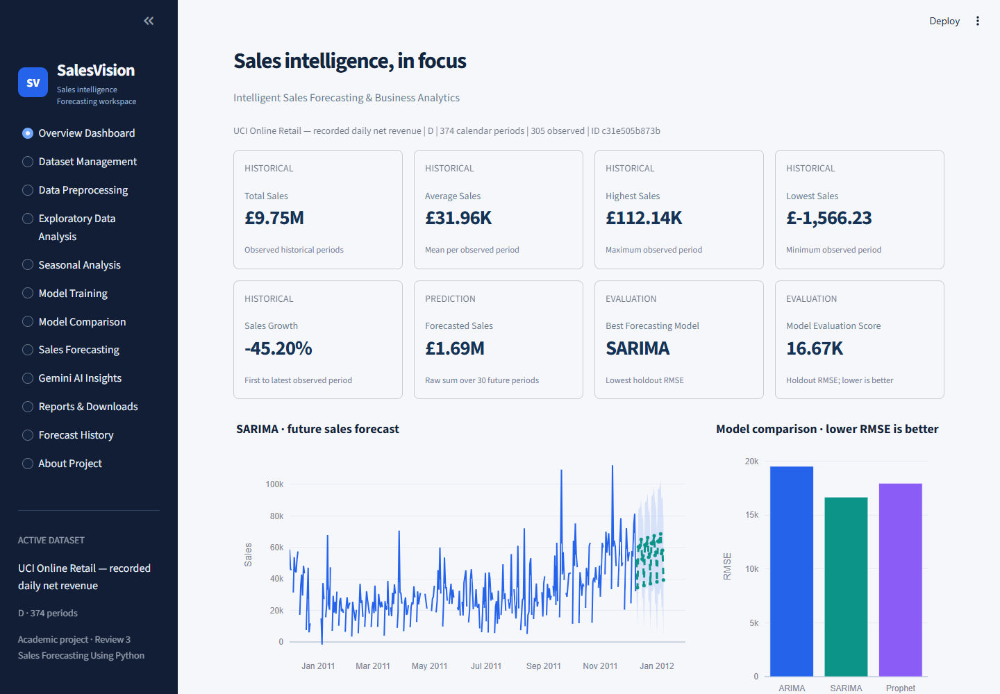

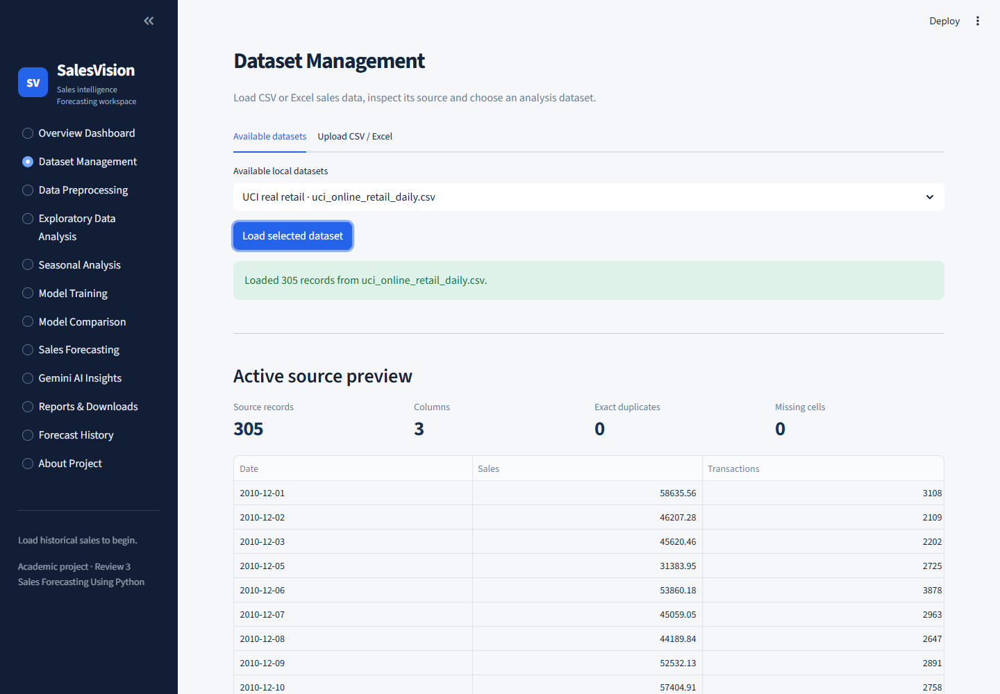

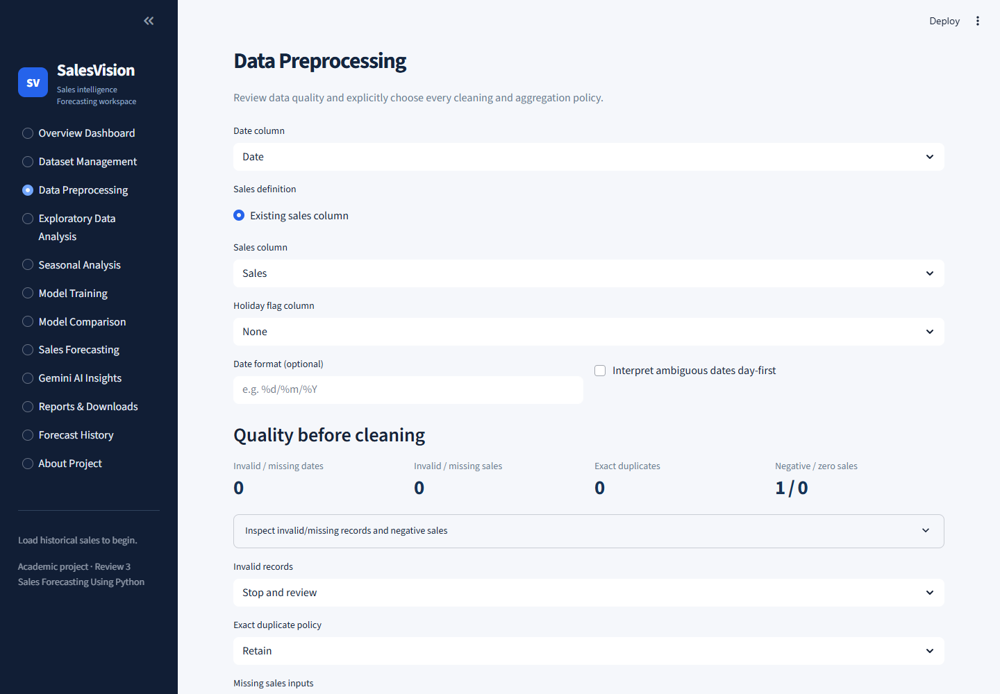

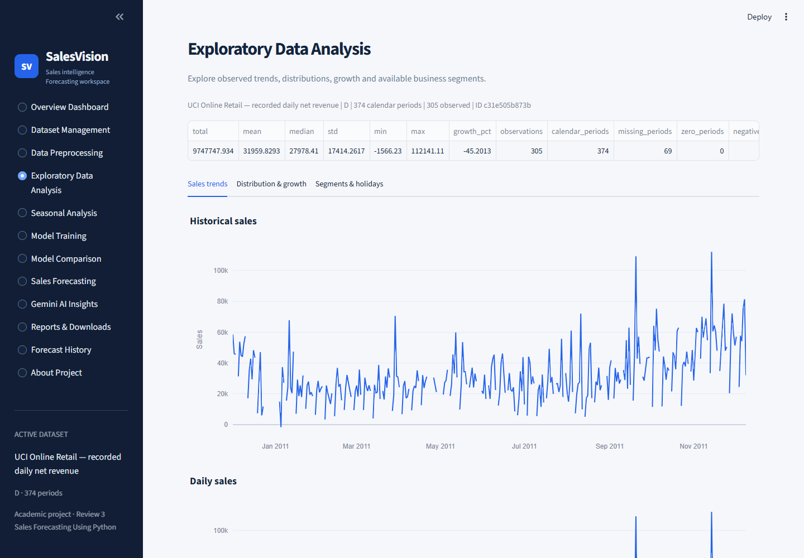

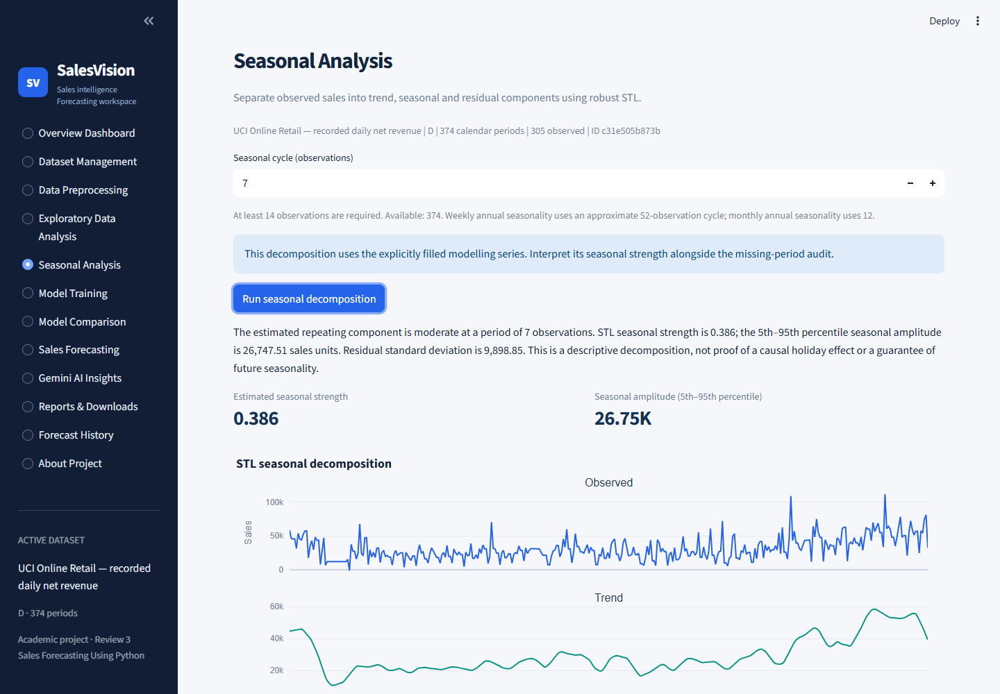

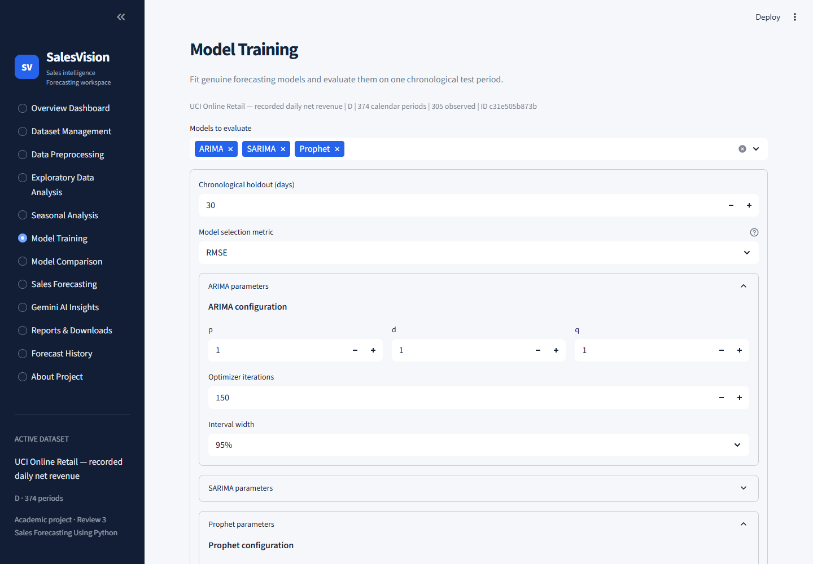

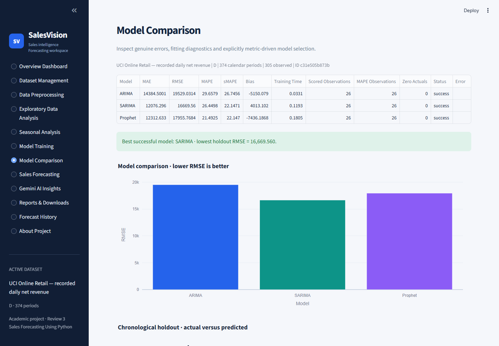

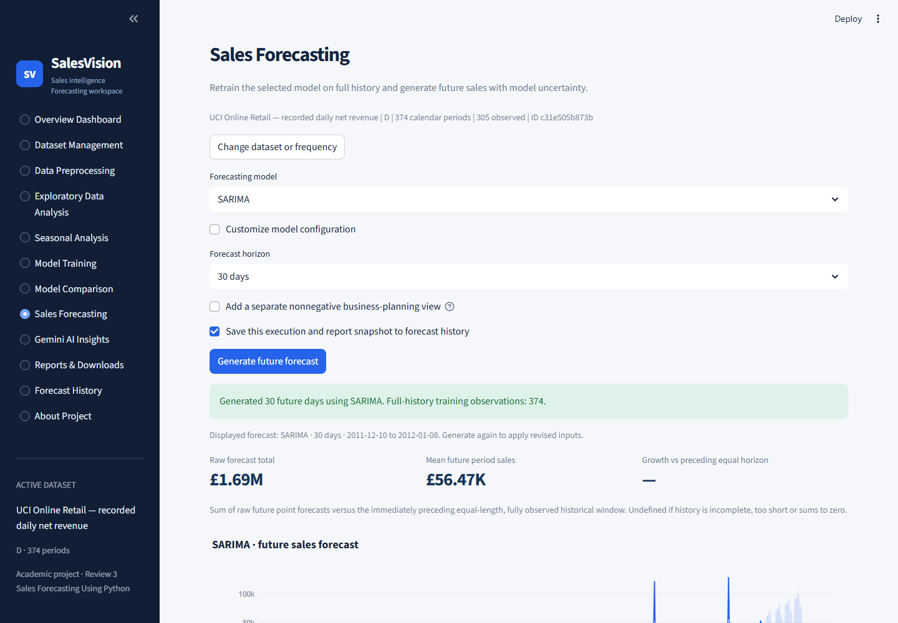

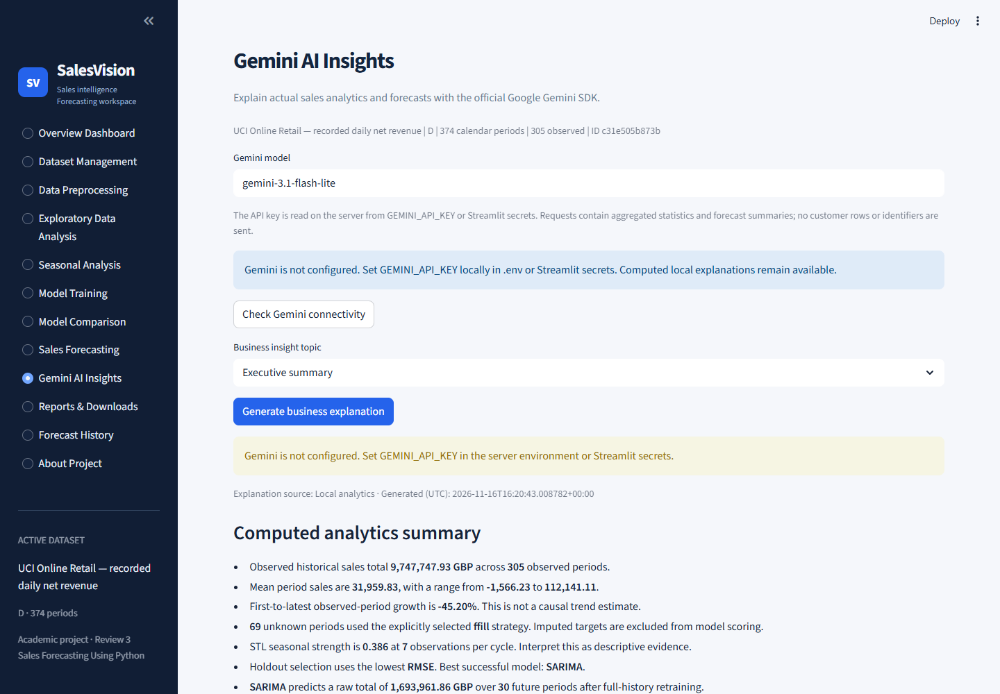

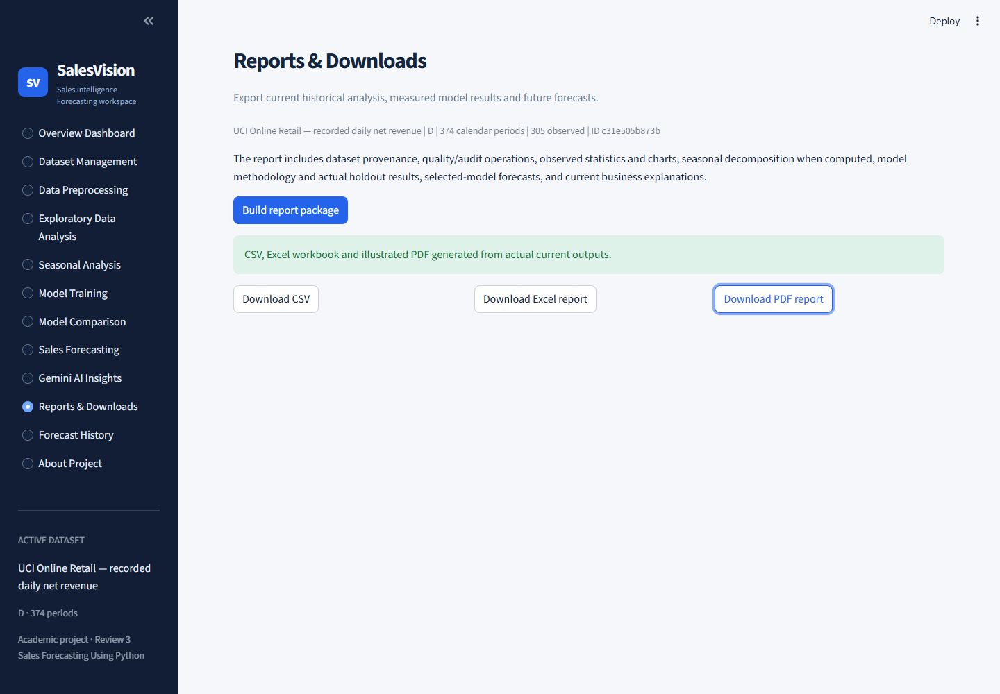

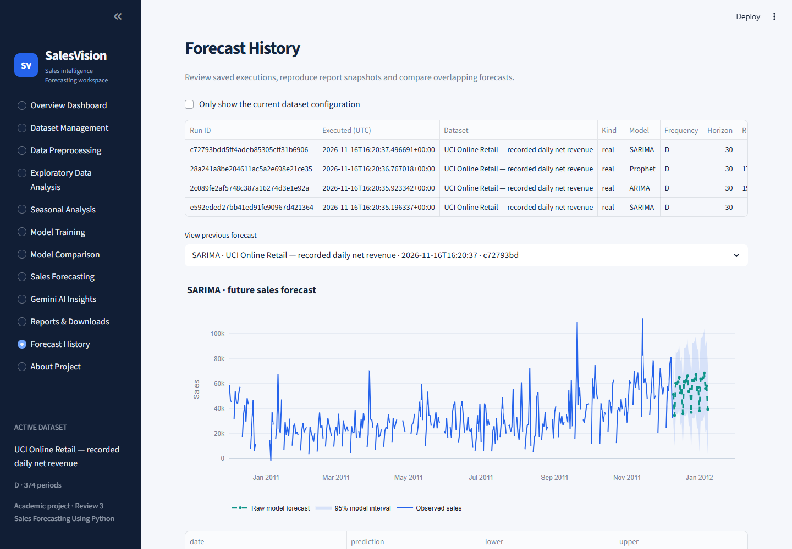

References: `docs/FINAL_PROJECT_AUDIT.md`, `docs/verification_summary.json`, `docs/methodology.md`, `docs/experimental_results.md`, `docs/screenshots/README.md`, `outputs/experiments/uci_daily/manifest.json`, and `notebooks/Sales_Forecasting_Experiments.ipynb`. Raw machine-local QA logs/databases are deliberately not shared. UCI attribution is Chen (2015), DOI 10.24432/C5BW33, CC BY 4.0; preserve it when sharing the derived sample. Library references: statsmodels.org, facebook.github.io/prophet, docs.streamlit.io, googleapis.github.io/python-genai.

## 12. Final quick reference

**Launch:** From the project root, `streamlit run app.py`, or the direct interpreter command below. Open printed localhost URL; Ctrl+C stops the server.

```powershell
Set-Location "D:\Project\MinorProject\sales-forecasting-system"
& ".venv\Scripts\python.exe" -m streamlit run app.py
```

**Reproduce:** UCI Date/Sales > daily sum > Retain duplicates/returns > Forward-fill (past values only) > Apply preprocessing > STL 7 > all models > holdout 30 > RMSE > folds 3/horizon14 > ARIMA(1,1,1), SARIMA(1,1,1)(0,1,1,7), Prophet additive/yearly Off/within-week On/prior0.05 > 95% > Train > Compare > SARIMA/30 days > Generate > Explanation source > Build report > History.

**Remember:** 305 observed / 374 calendar / 69 unknown; 26 scored holdout targets. SARIMA candidate RMSE 16,669.56 GBP; seasonal naive 15,328.04 is stronger. Historical future dates are not today. Gemini explains, Python forecasts. Unknown is not zero. Intervals are not accuracy or a joint-total guarantee. Never project credentials.

**Evidence to open:** baseline_comparison.csv; salesvision_report.xlsx/pdf in `outputs/experiments/uci_daily/`; actual screenshots; final audit; notebook. **Fallback:** saved verified evidence plus labelled Local analytics. **Close:** working integrated reproducible system, honest validation, explicit limits and future research.
