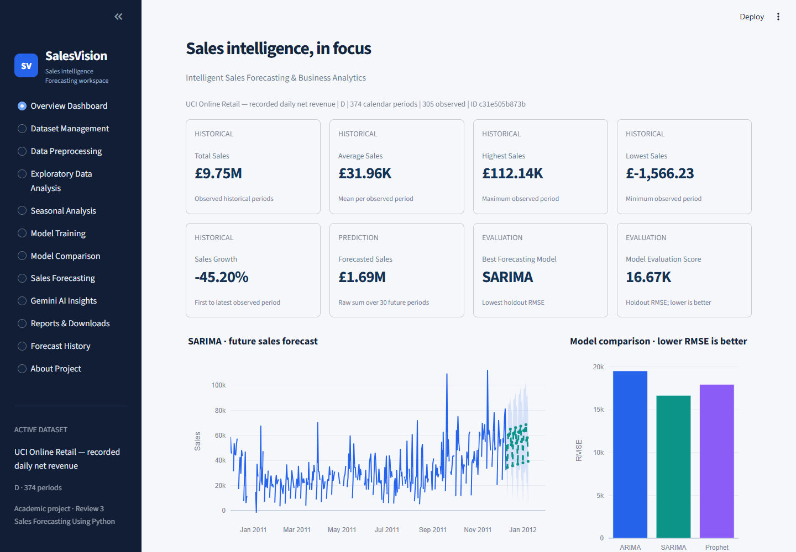
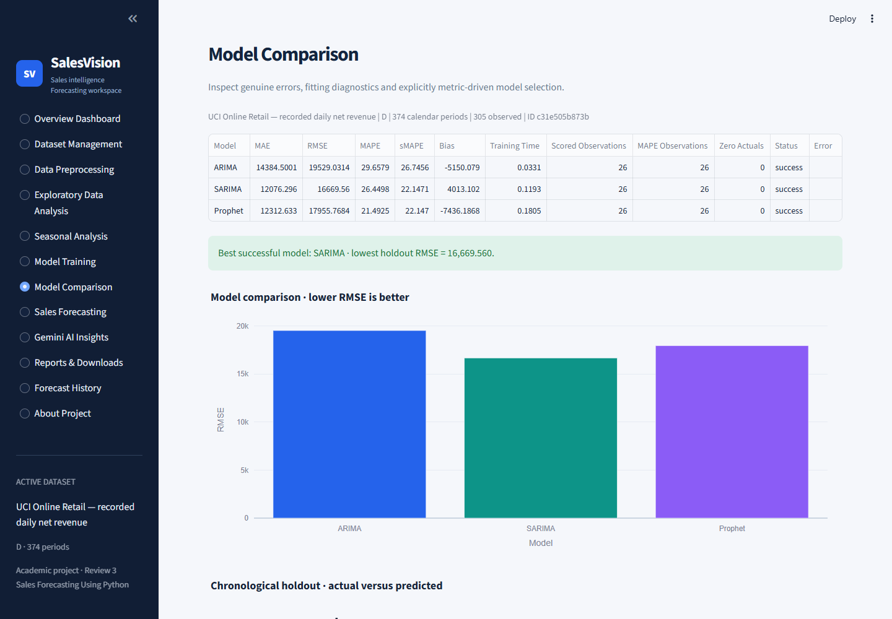
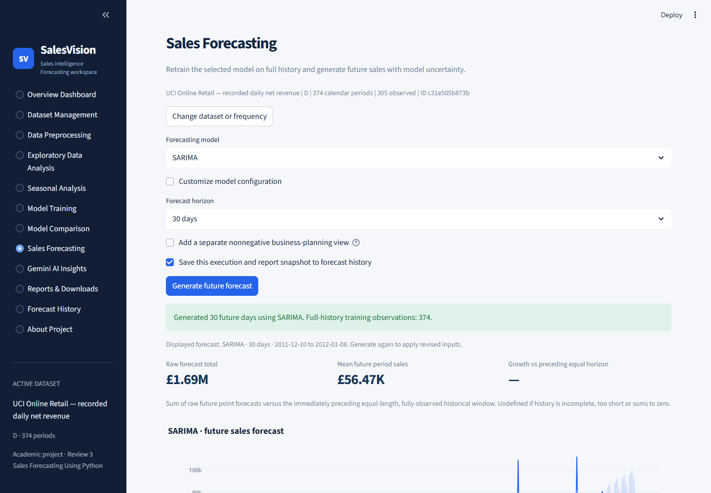
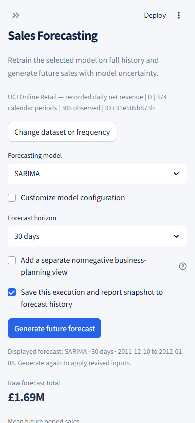

# Executed screenshot gallery

These are actual Chrome captures from the Streamlit workflow, refreshed on **2026-11-16** during the complete **63-check** browser audit with no JavaScript exceptions. That run verified all three models on daily, weekly and monthly data, as well as model/horizon persistence, uploads, reports and history.

Desktop viewport: **1440 × 1000**. Narrow viewport: **390 × 844**. Narrow checks cover all 12 navigation pages; these are resized browser views, not physical-device tests. Captures show visible page regions; tall pages have additional vertically scrollable content.

| File | Demonstrated content |
|---|---|
| [00-empty-overview.png](00-empty-overview.png) | Honest initial state before loading data |
| [01-overview-dashboard.png](01-overview-dashboard.png) | Eight computed KPIs, actual forecast and model comparison |
| [02-dataset-management.png](02-dataset-management.png) | Real UCI source load and preview |
| [03-data-preprocessing.png](03-data-preprocessing.png) | Explicit policies, audit and continuous calendar |
| [04-exploratory-analysis.png](04-exploratory-analysis.png) | Observed EDA and charts |
| [05-seasonal-analysis.png](05-seasonal-analysis.png) | Executed robust STL |
| [06-model-training.png](06-model-training.png) | Actual model controls and training |
| [07-model-comparison.png](07-model-comparison.png) | Measured common-holdout errors |
| [08-sales-forecasting.png](08-sales-forecasting.png) | Full-history SARIMA and 30-day displayed forecast |
| [09-gemini-insights.png](09-gemini-insights.png) | Clearly labelled Local analytics explanation from aggregates |
| [10-reports-downloads.png](10-reports-downloads.png) | Actual report generation/download controls |
| [11-forecast-history.png](11-forecast-history.png) | Saved runs and compatible comparison |
| [12-about-project.png](12-about-project.png) | Implemented academic methodology |
| [13-mobile-overview.png](13-mobile-overview.png) | Narrow overview layout |
| [14-mobile-forecast.png](14-mobile-forecast.png) | Restored SARIMA/30-day controls and forecast caption |
| [15-mobile-comparison.png](15-mobile-comparison.png) | Narrow model comparison layout |

## Overview

## Measured model comparison

## Future forecasting

## Narrow forecasting controls

## Interpretation

The source is recorded UCI GBP net revenue. Forecast dates belong to the archived dataset study. SARIMA wins the displayed three-candidate RMSE comparison; the separate experiment's seasonal-naive baseline has lower RMSE. Screenshot labels and compact numbers are presentation views of the actual exported outputs.

The complete run intentionally used Local analytics. A separate live Gemini recheck reached the model but generation returned temporary service unavailability; see [testing](../testing.md) and [the final audit](../FINAL_PROJECT_AUDIT.md) for the actual provider status.
